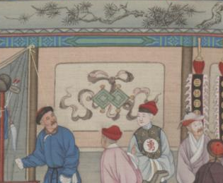
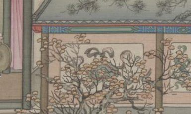
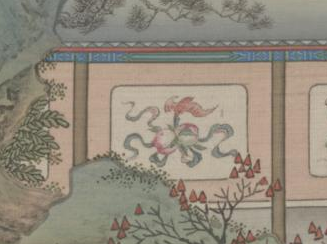
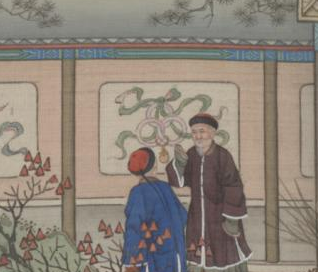

# 彩牆上的暗八仙：原畫位置與回看座標核對

2026-10-13｜康衢駢慶 v1.2。

## 原畫位置

直接查看 4500×2843 原生段落的四個局部，未放大、補畫或生成細節。四種均位於已登記的彩牆圖案位置。

| 圖案／人物 | 畫中位置 | 熱區 ID／現行原畫範圍 | 回看座標 |
|---|---|---|---|
| 玉板／曹國舅 | 左下彩牆，亭外觀看者上方；兩片並置的綠色長板 | wall-3；[333,2394,488,2493] | [410,2446] |
| 扇／漢鍾離 | 樂亭右旁彩牆；扇形器物部分被枝葉遮住 | wall-5；[1340,2405,1565,2503] | [1450,2470] |
| 荷花／何仙姑 | 右側院牆，花籃左旁；粉紅花瓣與綠色部分 | wall-13；[3410,2306,3577,2390] | [3495,2350] |
| 花籃／藍采和 | 荷花右旁牆格，兩位人物身後；花籃部分被人物遮住 | wall-14；[3620,2308,3778,2420] | [3690,2350] |

玉板原生局部：

扇原生局部：

荷花原生局部：

花籃原生局部：

## 發現與修正

1. 扇的舊範圍終於 y=2476，下緣尚有圖案；延伸至 y=2503，保留原 ID 和收藏類別。
2. 原先四種使用牆格外框中點回看，容易落在飄帶或圖案上方。新增獨立 anchor，對準圖案本體的可見部分。
3. 首次收集這四種時，寶物細節紀錄與該次首次類別紀錄均保存同一核對座標。
4. 讀入既有有效寶物紀錄時，保留發現與原熱區 ID，將寶物回看座標換成核對 anchor。既有暗八仙類別首次位置仍按原存檔保留；若從類別紀錄補回缺少的寶物紀錄，使用該寶物 anchor。
5. 見聞冊各寶物的「回看原畫」讀取 state.details 的座標。因此四個寶物按鈕各回到自己的彩牆，不使用暗八仙類別的單一首次位置代替。

## 已完成的確認

只執行純章節資料與座標函式，不啟動頁面、DOM 或瀏覽器，不讀取使用者瀏覽器存檔。

- 四種 anchor 都在各自登記範圍內。
- .45、.65、1 三種比例的四種 anchor，以及扇下緣 [1450,2484]：15 項命中均對應正確物件。
- 1920×1080、1440×900、390×844 三種視窗，套用回看移鏡比例 1、錨點 [.5,.56] 及畫作邊界約束：12 項的整個登記範圍均在視窗內。
- 玉板與花籃附近五個人物頭部中心：維持原人物命中，不由牆面收藏覆蓋。
- 詳細數值保留於 v1.2/motif-position-review/coordinate-results.json；原生裁切範圍保留於 original-crops.json。

## 尚未確認

以上支持原畫定位與座標對應正確，不等同實際點擊、手機觸控、見聞冊按鈕與畫面遮擋已通過。實際操作仍受先前本地頁面存取限制，需使用者提供录屏確認。扇被枝葉、花籃被人物局部遮擋是原畫內容，未以生成圖補齊。
