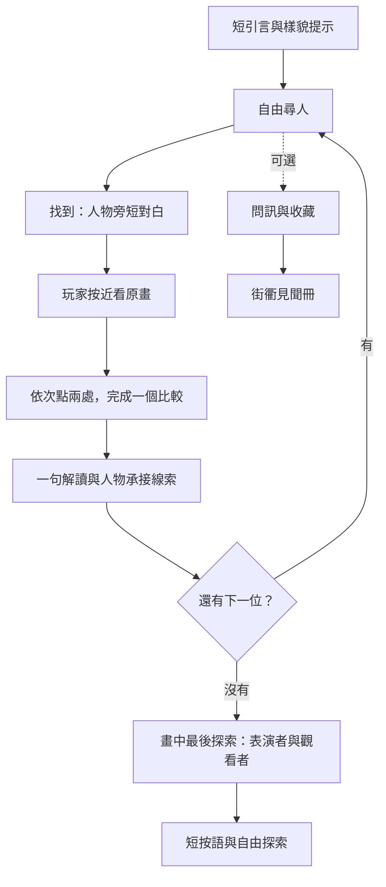

# 在人群中聽樂：《康衢駢慶》優化方案

版本：0.2 設計方案與代表效果｜更新：2026-10-11｜狀態：完整公開構圖、六地標定位、樣貌對照及五種介面效果已交付；正式章節待實作。

本輪入口：[五種介面效果](../../output/art-direction/wanshou-third-scroll/v0.2/effects.html) · [完整第三卷導航](../../output/art-direction/wanshou-third-scroll/v0.2/full-scroll.html) · [三張樣貌對照](../../output/art-direction/wanshou-third-scroll/v0.2/recognition.html) · [交付紀錄與限制](../../output/art-direction/wanshou-third-scroll/v0.2/delivery-record.md)。

**2026-10-12 內容定名修訂：**現行 v0.8 已完成本方案當時保留的研究工作：圓盤定名為鈸，彩繪牆面定名為暗八仙；三輪觀察改為亭內合奏、街衢儀仗與祝壽紋樣，並附故宮研究依據。見 [v0.8 修訂紀錄](kangqu-listening-content-v0.8.md)。本文件以下的「待查」「暫定」保留作設計歷程，不代表現行內容。

**2026-10-11 美術修訂 0.2.1：**使用者認為暫時效果理想，要求提升設計／按鈕美術與修正遮擋。已接入三張絹紙與按鈕素材，修正 SVG 尖角隱藏方式並清除殘留坐標；短尖角與對白放在人物上方空位。詳見[修訂與檢視紀錄](../../output/art-direction/wanshou-third-scroll/v0.2/ui/revision-0.2.1.md)。瀏覽器工具不允許讀取本地頁面，尚未完成新版排版及切換實際復核。

**0.2.2 再次修訂：**使用者截圖仍有原來長尖角，0.2.1 未解決使用者目前看到的遮擋。已完全移除獨立 SVG、改框內小尖角，交付[新入口內嵌快照](../../output/art-direction/wanshou-third-scroll/v0.2/effects-v0.2.2.html)；快取是否為原因未確認，瀏覽器端未復核。見[修訂紀錄](../../output/art-direction/wanshou-third-scroll/v0.2/ui/revision-0.2.2.md)。

**0.2.3 見聞冊修訂：**使用者不接受方形原畫照片配字符圖樣的冊子。已依已確認元宵冊頁方向製作四張原畫衍生去背插圖，總覽使用彩色／淡墨及文字狀態，擴闊兩列版面，詳情另開。見[直接開冊的新效果](../../output/art-direction/wanshou-third-scroll/v0.2/journal-v0.2.3.html)、[素材與提示詞](../../output/art-direction/wanshou-third-scroll/v0.2/journal-art/generation-records.json)及[修訂紀錄](../../output/art-direction/wanshou-third-scroll/v0.2/ui/revision-0.2.3.md)。素材已視覺檢視，瀏覽器排版尚未復核；完整收藏盤點與狀態仍待完成。

依據：[章節製作標準](../historical-painting-chapter-standard.md)、[章節設計模板](../templates/historical-painting-chapter-template.md)。按模板九部分重整；[0.1 實作紀錄](kangqu-listening-v0.1.md)保存現有內容與限制。

## 優化摘要與標準對照

**已確認基準（2026-10-11）：**使用者回覆「ok firm」，確認 0.2.3 見聞冊的去背手繪圖樣、彩色／淡墨與朱印狀態、兩列留白冊頁及總覽／詳情分步。後續收藏介面沿用此版；[確認與快照紀錄](../../output/art-direction/wanshou-third-scroll/v0.2/ui/journal-confirmation-0.2.3.md)。

保留清晰原畫、自由拖曳縮放、預設凝神，以及依次尋人後近看原畫的節奏。下一版把段落試玩發展成完整的原畫探索章節。

| 標準依據 | 目前情況 | 優化決定 | 完成時應看見的結果 |
|---|---|---|---|
| §4 完整原畫 | 只有 4,500 × 2,843 局部 | 取得完整第三卷底圖，逐段核對、定位高清細節 | 全卷可瀏覽；清晰區域按實際位置呈現，缺圖有紀錄 |
| §6 樣貌優先 | 全身人物卡，名字透露衣色、姿勢 | 改頭部去背樣貌；任務用「第一／二／三位畫中人」 | 初始不顯示衣身、鼓、手勢或地標；衣着與位置逐步揭露 |
| §5 必經觀察 | 點鼓、帽子、下擺後顯示說明 | 比較持物、手勢與人物朝向 | 每次一個問題，完成畫中操作才有解讀 |
| §7 人物覆蓋 | 三位候選可回應 | 逐人盤點全部可辨識人物，登記熱區與三句短回應 | 點其他清晰人物也有和眼前姿態有關的回應 |
| §8 支線收藏 | 尚無收藏 | 暫定四類見聞，全部同類位置登記、按類別去重 | 不同位置可解鎖同類收藏；冊中回到首次發現處 |
| §9 元件分工 | 對白、觀察、按語共用一框 | 分開人物旁對白、畫旁題箋、收藏通知與冊子 | 尖角指人；文字避開臉和待點細節 |
| §11 轉場與演繹 | 直接移鏡、無演繹 | 玩家主動近看，文字→鏡頭→文字；先做一個鼓旁樣段 | 短演繹可重播，結束回到原畫 |
| §12 畫中收尾 | 第三次觀察後立即總結 | 補最後一次觀看：亭內持樂器者與亭外觀看者 | 最後探索完成後才出按語和自由探索出口 |
| §13 狀態與操作 | 狀態集中單一腳本；鍵盤直達三位人物 | 主線／觀察／收藏／鏡頭分開；鍵盤按區域探索 | 合冊不改主線；重玩保留收藏；鍵盤不只列出答案 |

上表的「目前情況」記錄 0.1 起點；「優化決定」為設計要求。2026-10-11 的實際進度見 §9，未將設計決定當作功能完成或測試通過。完整底圖、樣貌辨認與全卷盤點是正式章節的必要條件；素材查核期間可並行製作介面與局部代表互動。

## 1. 章節簡介

| 欄位 | 內容 |
|---|---|
| 章節 ID／路由 | `kangqu-listening`；正式獨立入口擬為 `#kangqu-listening`，未接入 |
| 章節名／畫作原名 | 在人群中聽樂／《崇慶皇太后六旬萬壽圖》第三卷《康衢駢慶》 |
| 版本／日期／狀態 | 0.2／2026-10-11／代表效果稿；完整章節未接入，0.1 試玩另存 |
| 收藏機構／作者／年代 | 故宮博物院／清代張廷彥等；1751 年為慶典年份，不據此推定畫卷完成年 |
| 初中學生的必要背景 | 這是慶典長卷，可以沿街看人物與活動；術語在發現後才介紹 |
| 為甚麼值得探究 | 同一街衢並置持樂器者、行列、觀看者；衣着相近，姿態與位置仍不同 |
| 本章主要發現，最多三項 | 持物與雙手動作；相近衣着下的不同姿勢；朝向與活動空間的關係 |
| 尋找的角色／人物數量 | 暫定三位不同人物；沿用候選，樣貌不合格時更換，數量按全卷調整 |
| 支線收藏類別／數量 | 暫定四類：鼓、成對圓盤、旗幟、彩繪牆面；盤點後定案 |
| 是否需要原位動畫／理由 | 提議一個鼓旁短樣段，幫助觀看手與鼓的關係；原畫依據或接縫不合格時改靜態比較 |

**章節命題：**在《康衢駢慶》中尋找三位畫中人，從持物、姿勢與朝向，觀察慶典街衢中不同活動怎樣並置。

**核心問題：**同在這場慶典裡，畫中人都在做同一件事嗎？

**選畫判斷：**亭內、行列與牆外人物提供可比較的活動；三處已有清晰局部和坐標。相近服飾提供尋找空間，但全身清楚不能代替頭部辨認合格。一次找一人、看一個問題；收藏自由發現。完整公開構圖已核對卷首及兩端；全卷高清覆蓋與發布使用條件仍待確認，學生難度與完成時間未實測。

## 2. 原畫與來源

| 素材 ID | 完整原畫／局部／摹繪／演繹 | 機構與來源網址 | 尺寸與取得日期 | 使用條件 | 使用位置 |
|---|---|---|---|---|---|
| official-section-02 | 官方選圖二分段，非完整第三卷 | [故宮館藏頁](https://www.dpm.org.cn/collection/paint/232815.html)、[官方放大檢視](https://www.dpm.org.cn/dyx.html?path=/Uploads/tilegenerator/dest/files/image/8831/2015/0778/img0002.xml) | 原生 24,592 × 2,843；2026-10-10 核對 | 公開閱覽；外部發布條件待確認 | 現有局部來源 |
| stage-and-crowd-native | 原畫局部，已保存 | 同上，原生圖磚重組 | 4,500 × 2,843；2026-10-10 | 同上 | 試玩與代表效果稿 |
| scroll-base | 完整第三卷公開構圖，已保存並核對題名及兩端 | [公開來源頁](https://yihua.art/chong-qing-wan-shou-qing-dian.html)及原始 JPEG 連結 | 33,949 × 800；2026-10-11 | 公開閱覽；發布條件待查，非付費母檔 | 全卷導航 |
| recognition-01..03 | 三張頭部摹繪草稿，透明 PNG；未定為正式提示 | 原生頭部裁切及內建 Imagegen；完整提示詞另存 | 1,254 × 1,254，展示 128px；2026-10-11 | 生成細節不作原畫證據，原畫衍生條件待查 | 介面效果及原畫對照 |
| drum-motion-01 | 遊戲演繹，待樣段 | 鼓旁原畫姿態 | 未製作 | 與原畫使用條件分開記錄 | 玩家點擊後的可選演繹 |

### 完整原畫與高清定位

1. 官方四幅選圖已記錄尺寸，尚未證明覆蓋整個第三卷。先核對卷首、卷末、順序、重疊和缺段，不直接拼接後稱作完整全卷。
2. 完整底圖保持比例；高清分段以共同建築、欄杆和人物配準，記錄來源 ID、坐標轉換、重疊偏差。不同高度不直接拉伸並排。
3. 現有局部 x 加 8,000 即官方選圖二 x，y 相同；這不是全卷坐標。2026-10-11 已以六地標將本局部定位回公開完整底圖，保存坐標矩陣；最大錨點擬合殘差 0.443 底圖 px，只說明錨點擬合，不宣稱每個像素或其他分段均已配準。
4. 全卷按手卷方向由右向左探索；起始視角避開答案，導航用地標。低清、缺圖、色差和接縫逐段記錄；生成細節不作原畫證據。

素材：[原生局部](../../output/art-direction/wanshou-third-scroll/stage-and-crowd-native.png)、[來源及圖磚紀錄](../../output/art-direction/wanshou-third-scroll/source-provenance.json)、[候選坐標](../../output/art-direction/wanshou-third-scroll/candidates.json)、[四幅官方選圖核對紀錄](../../output/art-direction/wanshou-study/quality-review.md)。

### 解說證據表

| 解說主張 | 原畫位置／可見細節 | 類別 | 引用資料 | 待確認事項 |
|---|---|---|---|---|
| 鼓旁人物雙手向鼓，旁人持物不同 | 局部 974,2454 附近，坐姿、鼓、圓盤 | 原畫觀察 | 官方選圖二及原生局部 | 不先指定人物職分或圓盤樂器名稱 |
| 相近服飾仍有不同姿勢 | 局部 1447,1655 附近，抬手與鄰人放手 | 原畫觀察 | 同上 | 不推定抬手原因或全卷唯一性 |
| 朝向與彼此位置可一起看 | 局部 3755,2442，褐衣與背向藍衣人 | 原畫觀察 | 同上 | 不當作有史料證明的對話事件 |
| 一段街衢並置不同活動 | 亭內、行列、觀看者、牆外 | 原畫觀察與設計問題 | 同上 | 不推論所有人的心情、聽覺或全社會情況 |
| 手與鼓的小幅動作 | 鼓旁姿态 | 遊戲演繹，非原畫動作紀錄 | 原畫對照及未來素材紀錄 | 錨點、動作與接縫待樣段檢視 |

深層歷史解說另查資料；不為增加知識量而加入未核實的樂器制度、人物身分或畫家意圖。

## 3. 引言與入畫

| 步驟 | 畫面 | 短文案草稿 | 主要操作 |
|---|---|---|---|
| 背景 | 全卷方向與一處街衢 | 「慶典街衢裡，有人持樂器，也有人停步觀看。」 | 展開這一畫 |
| 任務與樣貌 | 首位乾淨頭部提示，不帶鼓、衣身與亭子 | 「記住這位畫中人的樣子。找到後，看看他與身旁的人。」 | 入畫尋人 |
| 入畫轉場 | 原畫就緒，紙箋淡去 | 「正在展開畫卷…」 | 就緒後開放探索 |

- 引言兩步，玩家推進；後兩位由人物短句承接，不重播背景。
- 樣貌卡只顯示必要頭部：面形、鬚髮、帽飾。初始任務、標題與語意標籤不透露「鼓旁」「紅衣」「綠色下擺」。內部 ID 可保留。
- 頭部去背、保持合理尺寸；桌面清晰提示圖先以約 120–160px 排版，這是待製素材的顯示範圍，不把現有十多像素面孔直接升頻到這個尺寸。
- 必要時摹繪，標「樣貌摹繪，原畫為準」，只能整理可核對特徵。原畫不足以確認面形、鬚髮或眉眼時換人或找更清楚來源，不自行補出辨認特徵。
- 三位均先做樣貌對照；未通過者替換。現有全身卡作第二層提示與研究對照，初始卡不展示。
- 入畫約 900–1100ms；減少動態時直接切換或短淡入，沒有觀看倒數。

## 4. 主線：找人 → 觀察 → 下一段線索

### 三輪主線草案

| 次序 | 目標 ID／原畫位置 | 樣貌特徵 | 找到後短對白 | 必經觀察操作 | 一句解讀 | 下一段線索 |
|---|---|---|---|---|---|---|
| 1 | seated-drum／局部 974,2454 | 頭部去背後核對面形、帽飾與鬚髮；未定稿 | 「看看我的雙手，再看看旁人。」 | 點鼓，再點鄰人的圓盤；逐步啟用 | 「同在亭內，人物的持物與雙手動作並不相同。」 | 「街上還有一列人，姿勢各有不同。」 |
| 2 | hand-at-hat／局部 1447,1655 | 頭部核對後定稿；抬手不作起始樣貌 | 「同行的人，姿勢各有不同。」 | 依次點抬起的手、鄰人放下的手 | 「衣着相近，仍能透過手的位置分辨個人。」 | 「院牆外還有人，看看他們朝向哪裡。」 |
| 3 | brown-green-hem／局部 3755,2442 | 頭部鬚髮、面形逐項核對後定稿 | 「看看我，再看看身旁那位。」 | 依次點褐衣、藍衣人物頭部，看朝向 | 「一人側向同伴，一人背向我們；位置連起了兩人的關係。」 | 「再看看亭內的人，和亭外觀看的人。」 |

三位為候選而非鎖定答案。第一輪較易以熟悉操作，第二輪比較相似服飾，第三輪觀察關係；難度仍待實際試玩。

### 提示階梯

| 目標 ID | 第一層：樣貌 | 第二層：衣著／動作 | 第三層：地標／區域 | 玩家要求後的移鏡範圍 |
|---|---|---|---|---|
| seated-drum | 核對後頭部提示，可再看 | 「黃褐色衣服，坐着，雙手向前伸。」 | 「看看有粉紅幔帳的亭子。」 | 整個亭子和鄰近街面；不標單人 |
| hand-at-hat | 同上，只說已確認的樣貌 | 「紅色花紋長袍，一手抬到帽邊。」 | 「亭前有一列衣着相近的人。」 | 行列與附近觀看者一起保留 |
| brown-green-hem | 同上 | 「褐色上衣，下面有綠色條紋。」 | 「看看彩繪院牆外的兩個人。」 | 院牆、兩人和周邊地物 |

- 分開「看區域提示」與「帶我看附近」；讀到第三層不自動移鏡，玩家主動操作才移到範圍，不圈答案。
- 承接短句只引向活動／地標，不提前報出衣色、動作和精確位置。
- 點對立即短回饋；按「近看原畫」才移鏡。一輪一個問題，點完第一處才出第二處提示；兩處完成才出解讀與繼續入口。
- 觀察直接點畫中細節，不要求答題、收藏或只按「知道了」。回看保留完成狀態，關冊不丟失未完成的一步。
- 樣貌難以辨認時先解決人物與素材，不靠模糊、細小熱區或提前洩露答案形成難度。

## 5. 全畫人物與物件盤點

完整底圖核對後，由右至左按建築和街面分段。現有局部先按亭內表演、亭前觀看者、紅衣行列、院牆外／遠景四類位置盤點。每人唯一 ID，記錄輪廓、可見特徵、三句回應、來源與是否主線／支線；太小、遮擋或無法分辨者也入表並說明原因。

| 熱區 ID | 人物／物件 | 坐標／輪廓 | 所屬局部圖 | 主線／對白／收藏 | 收藏類別 ID | 重疊處理 |
|---|---|---|---|---|---|---|
| seated-drum | 黃衣人物 | [930,2375,1018,2532] | official-section-02；全卷轉換待定 | 主線／對白 | 無，鼓另設物件 | 和鼓輪廓分開 |
| observation-drum | 紅鼓 | 舊框 [982,2450,1060,2538]，需調整外形 | 同上 | 觀察／自由收藏 | drum | 觀察與收藏分階段 |
| observation-discs | 鄰人圓盤 | 新輪廓，位置待登記 | 同上 | 觀察／收藏 | paired-discs | 物件優先，不被人物大框遮住 |
| hand-at-hat | 紅衣人物 | [1405,1560,1488,1749] | 同上 | 主線／對白 | 無 | 手部觀察另設輪廓 |
| observation-raised/resting-hand | 此人抬手、鄰人放手，各一 ID | 新輪廓，待盤點；替換帽子單點 | 同上 | 觀察 | 無 | 一次只啟用當步 |
| brown-green-hem | 褐衣人物 | [3710,2338,3800,2545] | 同上 | 主線／對白 | 無 | 與藍衣人分開 |
| observation-facing-heads-* | 兩人頭部，各一 ID | 新輪廓，待登記；替換下擺單點 | 同上 | 觀察 | 無 | 一次只啟用當步 |
| people-section-* | 其他可辨識人物，每人一 ID | 全卷盤點後登記 | 各分段 | 三句對白／按物件分支 | 視物件而定 | 禁用整群大框 |
| finding-drum/discs/flag/wall-* | 每個同類物件一 ID | 全部位置及輪廓待盤點 | 各分段 | 自由收藏 | 四類候選 ID | 人物與物件分框 |

舊框均為局部像素 `[x0,y0,x1,y1]`，只定位已有候選，不當作新觀察框或觸控校準已完成。

### 人物對白表：代表草稿

| 人物 ID | 原畫依據 | 首次對白 | 再次點擊 | 後續回應 | 虛構標示 |
|---|---|---|---|---|---|
| seated-drum | 坐姿、雙手與鼓 | 「看看我的雙手，再看看旁人。」 | 「我的面前，是這面鼓。」 | 「身邊的人，拿着不同的器物。」 | 遊戲虛構對白 |
| hand-at-hat | 抬手、相近衣着 | 「同行的人，姿勢各有不同。」 | 「我的手，正抬到帽邊。」 | 「也看看旁人的手放在哪裡。」 | 同上 |
| brown-green-hem | 朝向、背向藍衣人 | 「看看我，再看看身旁那位。」 | 「他背向你，我朝着他。」 | 「從我們的朝向，再看看位置。」 | 同上 |
| discs-holder-example，正式 ID 待盤點 | 亭內持圓盤者 | 「我手裡這對圓盤，你看見嗎？」 | 「兩手各有一片，仔細比比。」 | 「亭內的人，持物各有不同。」 | 同上，不擅定樂器名 |
| watcher-example，待位置與朝向核對 | 亭前觀看者 | 「順着我的朝向，看看亭子。」 | 「我身旁，也有人望向那邊。」 | 「換個位置，再看看我們。」 | 同上，核對後採用 |

其他人物逐人按可見細節寫短句，不大量複製「不是我」，也不推定人人聽見同一段音樂。點空白才用系統操作提示；人物說話和收藏通知分開。

### 互動覆蓋記錄

- 目前：三位候選與三處單點觀察；可辨識人物總數、完整第三卷總數未盤點。
- 新版：全部經盤點判定可辨識者可探索；未啟用者逐項寫原因，不能預先宣稱全人物覆蓋。
- 四類重複物件的總數／已登記數／未登記原因待盤點；不只登記一個示範位置。
- 觸控以約 44px 為起點；密集處要求放大，再處理輪廓和鄰近衝突，不把框擴張到旁人。
- 鍵盤先導航區域，再選區內可探索人物／物件；不僅跳到三個主線答案。移鏡只為讓玩家選擇的焦點可見，不提前透露目標名稱。

## 6. 支線與收藏

暫定《街衢見聞冊》四類，按可見形態命名；涉及器物學的名稱待查。全卷盤點可能合併、調整類別，不照搬元宵章節數量。

| 收藏類別 ID | 短名稱 | 全部可觸發熱區 ID | 收藏圖樣 | 未發現短提示 | 首次通知 | 重複回應 |
|---|---|---|---|---|---|---|
| drum | 鼓 | finding-drum-*，全部實例待盤點 | 原畫鼓形態圖樣 | 亭內，留意人物面前的圓鼓。 | 已收藏：鼓 | 這裡也有鼓，已記在冊中。 |
| paired-discs | 成對圓盤 | finding-discs-*，器物與位置待核對 | 成對圓盤輪廓 | 看看雙手各拿一片的人。 | 已收藏：成對圓盤 | 這對圓盤，也已記在冊中。 |
| flag | 旗幟 | finding-flag-*，不同顏色屬同類 | 原畫旗形態圖樣 | 街上有高高舉起的旗。 | 已收藏：旗幟 | 這面旗，也已記在冊中。 |
| painted-wall | 彩繪牆面 | finding-wall-*，須辨別牆與裝飾屏 | 牆面圖案圖樣 | 院牆上的圖案，也值得停步。 | 已收藏：彩繪牆面 | 這段彩繪，也已記在冊中。 |

| 類別 | 點擊時一句觀察 | 詳情短解說 | 原畫回看 | 資料來源 |
|---|---|---|---|---|
| 鼓 | 鼓在人物面前，雙手向它伸去。 | 看器物與手的位置，觀察人物動作。 | 首次發現位置 | 原畫；鼓種另查 |
| 成對圓盤 | 兩手各拿一片圓盤。 | 比較形狀與持法；正式名稱核對後補充。 | 同上 | 原畫；分類待查 |
| 旗幟 | 旗幟與持旗者沿街排列。 | 看旗形、顏色與位置，不先推定制度功能。 | 同上 | 原畫；制度另查 |
| 彩繪牆面 | 牆面也畫着不同圖案。 | 將裝飾與人物所在院落一起看。 | 同上 | 原畫；名稱待查 |

- 任一同類位置首次解鎖，每類只計一次，記住首次坐標與來源。同類另一處仍有回應。
- 主線觀察和支線獨立。完成觀察不強制收藏；觀察期間先完成當步，自由探索再點物件可收藏。不需收齊才完成主線。
- 收藏狀態先提交，再播放「點擊處顯現→飛入冊子→數量更新→通知」。首次飛行約 1200–1500ms、通知約 3 秒；重複約 900ms／2 秒，數量不增加。
- 飛行終點按當下冊子按鈕位置計算；減少動態或動畫失敗仍更新冊子與文字。
- 桌面原畫＋閱讀區並置；手機上下排列。總覽以圖樣、名稱、進度與留白構成，已發現／未發現兼用輪廓與文字。
- 詳情有圖樣、原畫位置、一句觀察、短解說、可展開來源。合冊恢復原鏡頭與凝神／彩色設定。
- 暫定收藏鍵 `chinese-wally:kangqu-listening:journal:v1`，與其他畫作及主線狀態分開。「再尋一次」重設主線與觀察，保留收藏；清空收藏另設操作。
- 存檔不可用仍可完成當次遊戲；集齊可開紀念頁，不增加必讀負擔。

## 7. 畫旁題箋與畫中收尾

| 步驟 | 原畫焦點 | 問題或短解說 | 玩家操作 | 完成條件 | 下一步 |
|---|---|---|---|---|---|
| 回顧主線 | 三處觀察 | 「持物、手勢、朝向，各自告訴了你甚麼？」 | 可選回看一處，不強迫重做三輪 | 按「看看街衢」 | 最後探索 |
| 最後探索 | 亭內持樂器者與亭前觀看者，位置待盤點 | 「看看持樂器的人，再看看朝亭子望去的人。」 | 依次點兩處原畫人物 | 兩處觀察完成 | 一句解讀 |
| 最後按語 | 上述人物關係仍可見 | 「同一段街衢，畫出了不同活動。持物、姿勢與朝向，讓我們看見人物之間的關係。」 | 自由探索／回看見聞冊／再尋一次 | 主線及最後探索完成，與收藏無關 | 畫中自由探索 |

收尾補上真正的最後觀看，把尋人與活動關係連起來，不重複衣色辨認，不新增「細看畫法」或獨立結業頁。歷史背景、作者、來源放選讀小記；沒有來源的解讀不補入。

## 8. 視覺與動畫規格

| 項目 | 本章選擇 | 沿用基準／理由 |
|---|---|---|
| 字體 | 本地 LXGW WenKai TC 為主、serif 備用；若加入宋體，全章仍最多兩套 | 保留已接受的紙絹與淡墨，文字保持活字 |
| 字級／行高／留白 | 對白 16–18px／1.5–1.65；題箋優先 20px／1.65–1.85；標題 20–24px；操作 15–16px；補充 12–14px | 先可讀再縮短；留白 8／12／16／24／32px |
| 配色 | 絹 #f1ead7、墨 #384333、朱 #93513d，實際畫面再檢視對比 | 與現有效果一致，避免厚重框飾 |
| 尋人卡／對話框／尖角 | 小型樣貌卡；對白一行為主，窄屏兩行；尖角依人物坐標定位 | 不擋臉、衣紋、待點細節 |
| 題箋 | 桌面約 350–420px，依內容調整；手機保留原畫可見區 | 問題和解讀分步，不與長對白同框 |
| 見聞冊 | 桌面並置、手機上下；不透明文字底色 | 關冊恢復玩家原視角 |
| 鏡頭與文字 | 淡出 160–200ms→移鏡約 440–650ms→停定再淡入 | 玩家觸發近看，不同時播放人物演繹 |
| 凝神／彩色 | 預設凝神，右上可轉全彩；玩家控制光區 | 畫卷拖曳與光區操作分清，手機操作提示明確 |

### 原位動畫表

| 動畫 ID | 原畫依據 | 點擊熱區 | 分層與錨點 | 動作／時長 | 結束恢復 | 標示 |
|---|---|---|---|---|---|---|
| drum-motion-01，候選樣段 | 人物雙手伸向鼓面 | 鼓觀察後主動按「看動作」，可略過 | 鼓、座位、下身固定；手臂層與接縫待核對 | 小幅動作，約 3–5 秒，可重播 | 同鏡頭原畫，之後才出解說 | 遊戲演繹，非歷史演奏復原 |

- 只先做一個樣段；連接不自然、錨點不可信或出現補丁時採靜態比較，不為熱鬧而添加無依據動作。
- 圖層去背，同色調、紋理與尺度；保留來源、處理方式、版本與提示詞。生成補背景屬演繹，不當原畫證據。
- 2026-10-11 已製作三張頭部去背摹繪草稿供效果排版與核對；部分面貌細節不可信，未定為正式提示。鼓旁動畫未製作，無動畫接縫評估結果。
- 配樂非主線必要。若加入當代示意聲音，玩家開啟、閱讀時安靜、標「示意」，不聲稱重現實際演奏；來源和授權另記。

## 9. 實作與交付記錄

### 2026-10-12：v0.7 起始視角及原畫邊界

使用者提供縮小時露出灰邊及來源黑邊的截圖，並確認放大入畫的 preset。已改為最低滿版倍率的 1.5 倍，縮放／平移均限制在顯示內容；導覽改為原比例小地圖。見 [修訂紀錄](kangqu-listening-view-v0.7.md)。本輪只檢視素材／源碼並組裝文件，未新增或執行測試、應用建置、瀏覽器／裝置操作。

### 2026-10-12：v0.6 元宵介面標準

使用者再次指定《宮中鬧元宵》為整個遊戲的標準。本輪完全排除效果稿樣式，直接沿用現行網站及元宵的 CSS、手繪圖示格號與五張共用介面圖像，統一按鈕、提示、絹紙題箋、對白、凝神及見聞冊。見 [介面對照與限制](kangqu-listening-interface-v0.6.md)。標準亦同步記入規範、模板及 AGENTS.md。本輪沒有執行測試、應用建置或實際瀏覽器／裝置操作。

### 2026-10-12：v0.5 版面修訂

使用者指出頁面與網站不同。本輪移除效果稿的常駐双欄，改成滿版原畫、讀入網站引言及角落尋人卡樣式、按需提示與小題箋，見聞冊才並排。詳見 [版面修訂紀錄](kangqu-listening-layout-v0.5.md)。已修改源碼及打包文件，未作瀏覽器／裝置檢視，沒有新增測試或應用建置。

### 2026-10-12：v0.4 主應用入口

承接使用者「next」，已把 0.3.2 來源接入 `#kangqu-listening`，另增 `#historical-paintings` 選單。新增獨立文件容器、載入回應／重試及返回入口，素材整理到主應用 public 目錄。沒有改元宵章節內容。本輪未新增或執行測試、建置、瀏覽器／裝置／學生試玩、Vite 啟動、推送或部署。見 [應用接入紀錄](kangqu-listening-application-v0.4.md)；以下舊版檢視仍按當時範圍理解。

### 2026-10-12：0.3.2 原畫坐標診斷

使用者同意進行檢視，並要求在沒有截圖時改用第二種方法。本輪採源圖坐標圖、源碼與純幾何規則檢查；不使用其他瀏覽器、伺服器或無頭渲染繞過本地頁面的工具限制。

已修正圓盤及抬手框計入頭部的誤觸、第二輪右旁手部框偏衣袖、對白框保護綠色下擺和待點物件，以及視窗尺寸改變後合冊的鏡頭中心還原。已實際執行 275 項坐標規則檢查，0 項失敗，並查看原生裁切及觀察／對白診斷圖。對白圖的框尺寸是幾何假定，不能據此宣稱實際排版或裝置操作通過。

交付：[0.3.2 修訂與六張診斷圖](../../output/art-direction/wanshou-third-scroll/v0.3.2/index.html)、[遊玩入口](../../output/art-direction/wanshou-third-scroll/v0.3.2/play.html)及[完整檢視紀錄](../../output/art-direction/wanshou-third-scroll/v0.3.2/inspection-record.md)。正式路由、實際瀏覽器操作、學生辨認、原位動畫及全卷高清仍未完成；以下舊版記錄保留作歷程。

### 2026-10-12：0.3.1 人物盤點與樣貌修訂

沿原生清晰段落作 18 個逐帶裁切及八處補充裁切觀看，新增 202 位人物／每人三句虛構對白、12 處帶原因的排除片段；原畫物件有效實例為鼓 2、成對圓盤 3、旗 25、院牆 14。小亭圓物移到待核，未因圓形或鄰人持物便當作同一人的一對。三張 v2 頭部以內建 Imagegen 重做，降低帽頂、鬚形與細紋推測，保留原生／v1／v2 對照；v2 仍是修訂候選。

已另建 [0.3.1 遊玩](../../output/art-direction/wanshou-third-scroll/v0.3.1/play.html)、[盤點圖](../../output/art-direction/wanshou-third-scroll/v0.3.1/inventory.html)及[樣貌頁](../../output/art-direction/wanshou-third-scroll/v0.3.1/recognition.html)。源圖坐標登記、衣身多邊形、人物頭部優先及對白遮臉判斷已寫入；舊小亭圓片存檔保留待核紀錄，收藏改為保存實際首次點擊坐標。

實際完成範圍見[覆蓋紀錄](../../output/art-direction/wanshou-third-scroll/v0.3.1/coverage.md)。未新增或執行測試、建置、瀏覽器、裝置或學生試玩；全卷其他區域高清覆蓋、源圖命中校準、頭像正式確認及動畫仍待完成。以下各舊版狀態作歷程保留。

### 2026-10-12：0.3 連續遊玩稿

承接使用者「ok next」，沿用已確認的 0.2.3 見聞冊，新增獨立 [0.3 遊玩入口](../../output/art-direction/wanshou-third-scroll/v0.3/play.html)。寫入引言、三輪樣貌尋人與兩點比較、最後亭內／亭前探索、四類收藏實際解鎖、首次位置保存、同類去重及合冊恢復鏡頭。完整公開底圖與清晰原生段落可在同頁切換。

本輪登記 20 位人物／每人三句虛構對白、45 處候選收藏實例（鼓 2、圓盤 4、旗 25、牆段 14）。參見 [覆蓋表](../../output/art-direction/wanshou-third-scroll/v0.3/coverage.md)、[熱區資料](../../output/art-direction/wanshou-third-scroll/v0.3/hotspots.json)及[交付紀錄](../../output/art-direction/wanshou-third-scroll/v0.3/delivery-record.md)。這是源圖盤點及程式實作，不代表全卷覆蓋或命中檢視通過。

尚未接入主應用正式路由。全人物／同類物件完整盤點、正式樣貌、全卷高清及原位鼓動作仍待完成。未執行測試、建置、瀏覽器、裝置或學生試玩。下列 2026-10-11 記錄保留作歷程；本版狀態以上述 0.3 交付為準。

### 實施順序

| 次序 | 工作 | 具體交付 | 完成條件／依賴 |
|---|---|---|---|
| A | 素材與選人核對 | 全卷來源／缺段表、三人樣貌對照、全人物與物件盤點 | 完整底圖與樣貌可核對；不足則換人或補來源 |
| B，可與 A 並行 | 代表介面效果稿 | 樣貌卡、人物旁對白、比較題箋、見聞冊、畫中收尾五種畫面 | 用已核對局部，標示效果稿；不補未確認的面貌 |
| C | 核心流程 | 引言→樣貌→逐次尋人→兩點比較→最後探索 | 一次一目標／問題；完成與退出清楚 |
| D | 全人物回應與收藏 | 每人三句、全部同類位置、去重／首次位置、冊子回看 | 依 A 盤點，不以少量示例稱作全卷完成 |
| E | 轉場與一個演繹樣段 | 移鏡、收藏飛行、鼓旁樣段與原畫對照 | 可略過；減少動態可完成；不可信則靜態 |
| F | 定稿檢視與交付 | 代表畫面、來源／對白／熱區／收藏表、素材版本、限制 | 按標準 §15 記錄實際結果；學生難度另行確認 |

### 實作結構建議

- 章節資料獨立，擬用 `src/game/kangquListening.ts`、`kangquPeople.ts`、`kangquCollection.ts` 與 `src/components/KangquGame.tsx`；尚未新增。
- 參考基準的坐標轉換、凝神、人物旁對白、題箋、收藏飛行與見聞冊。共用邏輯抽離皇帝／元宵硬編碼；完成章節內容保留。
- 分開主線目標、必經觀察、收藏、鏡頭／介面四組狀態。重播、合冊和收藏不改主線；熱區資料記優先關係。
- 轉場擋重複操作，結束／失敗均可恢復。載入、存檔與動畫失敗各有文字及繼續入口。
- 桌面、手機、鍵盤、減少動態共用同一答案與完成規則；實際排版與命中仍需檢視。

### 已確認、已完成與未完成（更新 2026-10-11）

- 使用者確認：現有效果理想，要求按兩份文件優化；回覆「ok」後開始製作完整底圖、樣貌核對及代表介面。這不等於正式樣貌、全部互動或完整章節定稿確認。
- 設計階段（2026-10-10）：按九部分模板寫優化方案及標準差異；0.1 試玩另存。
- 本輪完成：保存並看完整第三卷公開構圖及兩端；以六地標定位清晰局部；三張原生頭部與三張透明 Imagegen 摹繪草稿，保存提示詞及限制；製作五種可切換介面效果、第一輪兩點比較示例、見聞冊合冊視角恢復、最後兩處人物探索示例。
- 實際素材檢視：卷首題名及兩端、六地標位置、原生頭部與生成頭像、鼓原生裁切。摹繪第一位的完整鬚形、第二位帽頂與鬚髮需修訂，新增眉紋、皺紋、鬚絲不作線索。
- 五種 HTML/CSS/JS 介面已寫入；未執行瀏覽器排版、桌面／手機／鍵盤實際檢視、玩家測試、測試程式或建置。不宣稱功能、裝置或難度檢視通過。
- 未完成：全卷高清覆蓋、正式樣貌確認或替換、全人物與同類物件盤點、完整三輪主線、正式收藏與存檔、演繹、裝置及學生難度檢視。
- 本地入口：[0.2 本輪索引](../../output/art-direction/wanshou-third-scroll/v0.2/index.html)、[五種介面效果](../../output/art-direction/wanshou-third-scroll/v0.2/effects.html)、[完整構圖](../../output/art-direction/wanshou-third-scroll/v0.2/full-scroll.html)、[樣貌對照](../../output/art-direction/wanshou-third-scroll/v0.2/recognition.html)。未部署；0.1 段落試玩保留。
- 詳細素材、操作與界線：[交付紀錄](../../output/art-direction/wanshou-third-scroll/v0.2/delivery-record.md)。

### 定稿標準完成紀錄

| 項目 | 狀態 |
|---|---|
| 章節命題與代表原畫證據 | 方案已寫；三處局部可對照 |
| 完整原畫與全卷定位 | 完整公開構圖及清晰局部六地標定位完成；全卷高清未齊 |
| 樣貌提示與分層揭露 | 三張透明草稿與提示效果已製作；樣貌特徵需修訂或換人，未正式定稿 |
| 比較觀察與最後探索 | 第一輪及最後探索示例已寫入效果稿；完整主線待接入 |
| 對白、尖角、全人物熱區 | 坐標對白效果已寫；全人物待盤點、實作 |
| 多處同類收藏、去重、冊子回看 | 冊子及合冊恢復視角示例已寫；完整位置／去重／存檔待實作 |
| 演繹、轉場、手機／鍵盤／失敗處理 | 介面及部分操作已編寫；演繹、裝置實際檢視未完成 |
| 學生難度、正式定稿 | 未進行；對 0.1 效果的肯定單獨記錄 |
