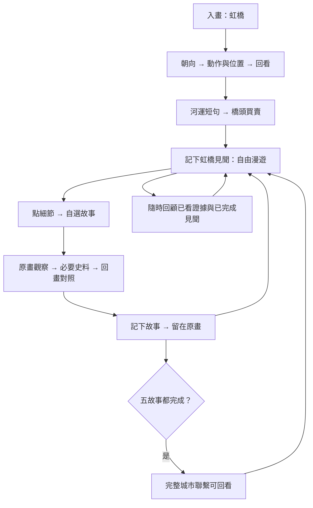

# 《清明上河圖》虹橋引導與自由漫遊正式設計

版本：設計 v1.0｜日期：2026-10-14｜狀態：已確認流程的正式整理；現行實作進度見[遊戲 v0.6 製作紀錄](qingming-free-roam-implementation-2026-10-14.md)。

**2026-10-15 虹橋更新：**使用者確認「讓玩家先看出奇怪之處，再出現一句追問」。第 3 節及第 4.2 節已同步正式遊戲的新版虹橋；五個自由故事仍保留原流程，尚未逐一改寫為這個新節奏。書冊及見聞冊接入見 [v5.5 接入紀錄](qingming-v55-integration-2026-10-15.md)，本輪效果與限制見 [好奇先行紀錄](qingming-curiosity-2026-10-15.md)。

**同日去處入口更新：**使用者選擇「每次推薦一處，可以換」。去處入口改為畫旁小絲箋，一幅既有原畫局部、一句引子及短描述，操作為「去看看／換一處」，移除五段問題的總選單及第二層確認。實作與實際檢視見 [去處推薦紀錄](qingming-destination-2026-10-15.md)。

**2026-10-20 船上更新：**「船窗裏的人」已接入，沿用原色留步、點畫追問、必經原畫證據、畫中收束與冊中重看。舊版船上清單移到選讀；第 4.4 節為現行方向。

**2026-10-19 街道收斂：**使用者確認「點人物／轎身 → 沿杆看聯繫 → 找同頂轎另一端的人 → 畫中揭曉」。車與牲口比較移到選讀，原早版紀錄保留作歷程。第 4.3 節與 [實作紀錄](qingming-pole-story-2026-10-19.md) 為現行方向；其餘四故事保留原流程。

依據：[章節製作標準](../historical-painting-chapter-standard.md)、[章節模板](../templates/historical-painting-chapter-template.md)。沿用模板九節結構；尋人相關欄位按使用者最新決定改為場景觀察。本文是下一輪製作依據；[原章節文件](qingming-shanghe.md)、五人接力文件與 v0.5 遊戲保存為製作歷程，不再作新玩法的流程依據。

## 1. 章節簡介

| 欄位 | 內容 |
|---|---|
| 章節 ID／路由 | qingming-shanghe／#qingming-shanghe |
| 畫作 | 北京故宮博物院藏，張擇端北宋本《清明上河圖》 |
| 本輪範圍 | 虹橋引導、五個自由漫遊故事、隨時回顧、五故事完成後的城市聯繫 |
| 共用介面 | 《宮中鬧元宵》現行按鈕、手繪圖示、題箋、人物對白、見聞冊、字體與操作層級 |
| 必要背景 | 東京即汴京；方物、仰給等詞在出現時短註 |
| 主要發現 | 水陸運輸連起城市生活；店舖以招牌、裝飾與陳列展示生意；城市包含不同商品與專門服務 |
| 人物角色 | 不再要求五位指定人物接力；人物提供原畫細節相關的短回應 |
| 故事數量 | 一段必經虹橋引導＋五個可自由選序的故事 |
| 收藏 | 保留現行六類物件見聞去重；故事進度另存，不由物件收藏推定完成 |
| 原位動畫 | 本輪不新增人物工作演繹；保留原畫，以回看和比較表達關係 |

**章節命題：**在《清明上河圖》中探索人物、物件與場景的聯繫，配合《東京夢華錄》短句，理解北宋城市的運輸、商業與服務。

**已確認決定：**玩家從原畫細節自行拼出小故事；虹橋開始短程引導；之後自由漫遊；觀察、回看、記下發現，全程不用選擇題；船上工作可保留疑問，不指定每位人物身份或工作；隨時回顧已發現見聞，五故事完成再補完整城市聯繫。

**選畫判斷：**長卷關係豐富，但全畫搜尋指定小臉負擔較大，故以場景問題引導局部觀察。清晰度不足的字與人物不補造細節。學生難度與完成時間尚無試玩證據。

## 2. 原畫與來源

| 素材／來源 | 用途與記錄 |
|---|---|
| 完整原畫，38414×1800 | `docs/art/qingming/source/alongtheriver-qingming.jpg`；現行分塊位於 `public/art/qingming/`。取得及處理歷程見原章節文件與實作記錄 |
| [故宮藏品介紹](https://www.dpm.org.cn/collection/paint/228226.html) | 版本、作者與場景背景；不把研究者的危機或創作意圖解釋定為唯一答案 |
| [原畫來源頁](https://commons.wikimedia.org/wiki/File:Alongtheriver_QingMing.jpg) | 數位素材來源；使用條件沿用既有來源記錄，本輪未重新查核 |
| [故宮講壇](https://www.dpm.org.cn/forum_detail/99722.html) | 醫藥鋪、紙馬鋪等來源指認；區分小字可讀事實與文獻釋讀 |
| 《東京夢華錄》[卷一](https://zh.wikisource.org/zh-hant/東京夢華錄/卷一)、[卷二](https://zh.wikisource.org/zh-hant/東京夢華錄/卷二)、[卷三](https://zh.wikisource.org/zh-hant/東京夢華錄/卷三)、[卷七](https://zh.wikisource.org/zh-hant/東京夢華錄/卷七) | 沿用既有已核對短句；孟元老南宋追記北宋東京生活，背景放在冊中選讀。異文及校注限制沿用原章節記錄 |

座標為全畫像素，左上原點，格式 `[左,上,右,下]`。下表是原畫定位，不直接等於最終可點輪廓；個別熱區以現行盤點的校核座標為準。

| 場景／原畫證據 | 現有定位與 ID | 解讀範圍／限制 |
|---|---|---|
| 虹橋探看人群、船上動作、船橋位置、橋頭攤位 | `bridge-people` [19150,125,19875,305]；`bridge-boat` [19460,420,20435,822]；`landmark-bridge` [18870,146,20155,570]；`bridge-stalls` [18250,390,18640,750] | 比較動作與位置；不斷言碰撞或事故。人物仍用個別熱區 |
| 酒樓前轎子、負載牲口與載物獨輪車 | `extra-object-city-039/040`、`042/043/044/045`；局部範圍約 [4100,850,5800,1450] | 看運輸結構與道路共用；不杜撰讓路或爭執 |
| 同一艘前景立桅大船 | `extra-object-river-058` [23553,310,25288,1243]；`extra-person-outskirts-104/105` 為艙棚內俯身與站立人物 | 船身、艙棚、桅杆索具及人物連續；不混入後方另一艘 `river-059`。工作與身份不定論 |
| 酒樓招牌與彩飾 | `wine-sign` [4475,779,4555,923]；`wine-decoration` [4395,275,4925,777] | 原畫門面與史料活動類型對讀 |
| 醫藥鋪店名、宣傳、店內人物與器物 | `medicine-name` [1455,596,1670,653]；`medicine-advertisement` [1440,659,1488,910]；`extra-object-city-006`；店內個別人物 | 不指定醫者或病人；史料其他醫鋪的專科不套到趙太丞家 |
| 紙馬鋪店招與陳列 | `paper-sign` [26882,49,26936,240]；`paper-display` [26952,66,27142,240] | 成排板狀、立架、懸掛物為可見形態；不逐件說成紙製樓閣，不認定旁人正在購買 |

局部素材：`bridge-scene.jpg`、`wine-scene.jpg`、`medicine-scene.jpg`、`paper-scene.jpg`；全畫盤點與回應見 [coverage-table.md](../art/qingming/inventory/coverage-table.md)。運輸與船上工作專用展示裁圖尚未製作。

## 3. 引言與入畫

起始鏡頭包含虹橋、橋下船隻及兩岸；不先展示指定人物頭像。進入畫面後玩家可拖曳、縮放及自行控制凝神。

| 畫面 | 題箋文案 | 操作 |
|---|---|---|
| 虹橋全景 | **在橋邊停一停。** 入畫後只留「點看讓你想多看一眼的人物。」；不先指出前傾動作或船的位置 | 開始觀察，然後直接點人物 |
| 素材載入 | 畫卷準備中。 | 素材就緒才開放入畫；失敗保留重試入口 |

保留現行入畫轉場；減少動態時直接切換或短淡入。主動選擇近看才移鏡頭，不自動追着答案移動。人物去背頭像不再承擔主線入場任務；原有素材保留為歷程，不等於問題已修正。

## 4. 虹橋引導與五個故事

### 4.1 共用操作規則

- 一次只展開一個故事、一個問題。題箋回應是原畫觀察文字，人物短對白另框並標示遊戲虛構對白。
- 自由故事提前點看細節時保存「已看」紀錄；虹橋只記錄當前觀察目標，避免提前點船便略過人物。閱讀後的回畫對讀與關係回看仍需實際完成，不能被閱讀前的偶然點擊跳過。
- 點擊物件或相應人物均可提供觀察入口；可支持同一步的全部實例須登記。集體觀察區不能蓋掉個別人物的回應。
- 自由故事看過一步後，由玩家按「繼續看看」推進。多點比較在同一題箋顯示短進度，例如「已看一處，還可比較另一處」。虹橋前段以點中原畫目標換到下一處觀看，短按語、合卷與收下見聞則由玩家主動推進。
- 點到其他人物保留其回應；點背景不推進、不扣分。重點已看細節回應「這處已看過，還可以比較……」，不重播完成通知。
- 提示由玩家主動索取：原畫特徵 → 相鄰位置 →「帶我到附近」。不圈出唯一答案；密集小物先讓玩家主動近看。

### 4.2 虹橋引導 `intro-bridge`

| 步驟 | 題箋 | 點擊／操作與條件 | 回應／下一步 |
|---|---|---|---|
| B1 遇見人物 | 在橋邊停一停。開場沒有下方觀察題箋 | 正常彩色；點橋欄邊可支持探看動作的個別人物 | 立即聚焦橋欄邊，先讓玩家觀看姿勢 |
| B2 好奇與追問 | **這幾個人，正在留意甚麼？** | 聚焦後約 1.6 秒才出現題箋；由玩家點橋下大船的位置 | 轉到船上光區；不以「再看船上」按鈕代替原畫點擊 |
| B3 尋找動作證據 | **留意船左側伸出的手臂。點那個人看看。** | 船上光區先出現，約 1.2 秒後出提示；點 `extra-person-river-231` | 船身及其他細節不代替此人物；點中後合看橋船 |
| B4 一小段故事 | **橋邊的探看，與船上的忙碌，在這一刻交會。這些人是否正在互相呼應？畫中仍留着疑問。** | 合看約 1 秒後顯示短按語；玩家按「看過了」 | 才出現新的城市疑問與薄冊，不自動開書 |
| B5 史料 | **河上的往來，又怎樣連着城裏的生活？** | 主動翻開〈河道〉，點原文才出批注；「凡東南方物，自此入京城」為相關必讀段落 | 合卷後回到原畫；其餘短句批注選讀，長解說冊中選讀 |
| B6 回畫對照 | **書中說物產沿汴河入京。回到畫中，點這艘大船，對照書中的河運。** | 閱讀後重新點大船，先前點擊不抵銷此步 | 聚焦橋船並顯示河運與城市按語 |
| B7 收下見聞 | **河上的船，連着京城的供應與往來；眼前這艘船載甚麼，仍不能確定。** | 玩家按「收下這則見聞」 | 收藏去重，完成後可「自行漫遊」 |

B3 回應須按實際人物匹配，未伸臂的人不得套用伸臂句。船身與人物是不同觀察目標；不得把現行 `bridge-boat` 人群區直接冒充所有船身細節。文字延後只控制顯示，不鎖住畫卷，不由停留時間推進；玩家在追問出現前已自行找到下一處，仍接受其原畫點擊。

完成題箋：**你已讀出一段橋邊見聞**。橋邊的探看、船上的動作，一起記在這則見聞裏。接下來，選一處你想停留的地方。

操作：「自行漫遊」收起題箋並保留鏡頭；「給我一個去處」在畫旁推薦一處，保留大部分原畫，不遮暗或鎖住畫卷。「換一處」只更換邀請；「去看看」才移到場景附近並收起邀請。抵達後先看畫，點相應人物或物件才展開該故事，不另按「展開這段觀察」。推薦優先輪換未完成故事；全部完成後可推薦舊場景回看，不重設完成狀態。叉號或 Escape 可收起。

### 4.3 長杆兩端的人 `story-street-transport`

2026-10-19 收斂版，取代同日稍早的車輪與牲口必經比較。故事 ID 保留，進度版本為 3。

推薦只顯示「到街上停一停。」；抵達包含兩頂轎子的一帶，保持原色，不先出追問。點相應人物或轎身才開始，不另按展開按鈕。

| 步驟 | 題箋與操作 | 原畫條件 |
|---|---|---|
| T1 留步 | 自行看畫、點人物或轎身 | 六位既有轎旁人物與兩頂轎身。其他人物仍有自己的回應 |
| T2 沿杆看 | 人物先：「他肩上的／扶着的／身旁的長杆，另一端連着甚麼？」轎身先：「沿着轎旁的長杆，看看有哪些人與它連在一起。」 | 人物先須點同頂轎身；轎身先須找相連人物。第一次點擊即聚焦，追問稍後出現 |
| T3 另一端 | 「再沿着長杆看看，另一端還有誰？」直接點原畫人物 | 依已看人物所在端，只接受同頂轎另一端的人。左轎：148 ↔ 150/151；右轎：153 ↔ 155/156。另一頂轎、同一端人物不代替 |
| T4 合看 | 「長杆連着轎身，也連着兩旁的人。幾個人的動作，在這裏接了起來。」 | 合看實際所選的一頂轎與兩端人物，柔邊聚焦、不加框。主動收下後直接漫遊，不再接重複總結卡 |

人物 ID 均為 `extra-person-city-…`，兩頂轎為 `extra-object-city-039/040`。實際點擊與來源幾何見 [實作紀錄](qingming-pole-story-2026-10-19.md)。

車輪及負載牲口保留為自由觀察，在冊中「街上還有哪些運法？」選讀；曾觀察的位置可回看，不再是本故事完成條件。長杆與轎旁人物的關係不硬配一段未核對史料。其餘四故事與虹橋的圖文對讀保留。

舊版已完成故事仍完成，收藏與舊車輪／負載證據保留；未完成者只沿用實際看過、且符合當前同頂轎關係的證據。不能憑舊車與牲口紀錄推定看過另一端人物。冊中可重看已完成街道互動：途中暫存不重設完成紀錄，完成重看才更新本次實際走過的人、轎、另一端證據；見聞與收藏數不重複增加。

### 4.4 船窗裏的人 `story-boat-work`

2026-10-20：使用者確認以船窗露面的身影引起好奇，取代站立／俯身、桅杆／索具的必經清單。故事 ID 保留，進度版本為 2；使用既有 `story-boat.jpg` 與全卷原畫。

推薦：「到船邊停一停。」不先說出要找船窗或比較姿態。抵達船邊保持原色，點船窗左／右露面人物才出現聚焦與追問；其他人物保留自己的回應。

| 步驟 | 題箋與操作 | 原畫條件 |
|---|---|---|
| S1 留步 | 自行觀看、點露面身影，暫無追問 | `extra-person-outskirts-034/035`，任何一位均可 |
| S2 船窗 | 「他從船的哪一處露出臉來？」直接點人物身旁木框／船舷 | `detail-boat-window`，原畫範圍 [23945,1045,24120,1165]。人物臉部優先，不以再點人物代替看木框 |
| S3 同船其他人 | 「同一艘船上，其他人在哪裏？」 | 同一前景大船的 `extra-person-outskirts-033/104/105`；後方另一艘船的 024 不代替 |
| S4 合看 | 「船窗裏有人露面，艙棚旁有人直着身子。船的內外，都留着人的身影。」 | 中句依實際所看對象改成「船舷邊也有人」或「艙棚旁有人俯着身」。柔邊合看前景同船，不加框；主動收下後直接漫遊 |

不從露臉判定坐姿、休息或乘客身份，不命名卸貨、修船、煮食等工作；不新增演繹來填補疑問。兩位船窗人物的舊坐姿名稱與休息對白改為可見位置的描述，對白仍標為遊戲虛構。

桅杆、繩圈與其他舊觀察保留在冊中「船上還有甚麼細節？」選讀，已看位置可回看。同位置的舊證據去重顯示。舊版誤併為同船的 024 保留為「附近另一艘船上的人物」，不再據此推進本故事。虹橋已讀的河運短句仍可在冊中翻閱，不強制重讀，也不把河運短句當作船窗人物身份的證明。

完成數及收藏保留；舊版部分進度保留實際已看細節，從新的船窗發現開始，不偽造已看船窗。已完成故事可重看，重看完成才更新本次三處證據，完成數不重複增加。實作與實際檢視見 [船窗故事接入紀錄](qingming-boat-window-2026-10-20.md)。

### 4.5 酒樓門面 `story-wine-front`

開場：這間店的門面有不少裝飾。路上的人，可以從哪裏認出它？

| 步驟 | 題箋 | 點擊對象／條件 | 點擊回應 |
|---|---|---|---|
| W1 | **先找店招** 門面附近，哪裏寫着字？ | `wine-sign` | 這塊牌上可辨認「正店」二字。 |
| W2 | **再看入口** 門前除了招牌，還掛着甚麼？ | `wine-decoration` 的門架、彩飾或懸掛物 | 門架上有彩飾和懸掛物，入口裝點得很醒目。 |
| W3 | **書中怎樣寫酒店門面？** | 必經卷二〈酒樓〉短句，按「回畫中對照」 | 「凡京師酒店，門首皆縛彩樓歡門。」彩樓歡門：店門前的彩飾門架。 |
| W4 | **回看整個門面** 把招牌與入口裝飾放在一起看。 | 閱讀後回點店招或彩飾，鏡頭保留兩者關係 | 招牌提供辨認線索，入口裝飾則讓門面引人注意。 |

完成按語：原畫的店招與彩飾，可以和書中的酒店門面對讀，看見店舖怎樣在街上展示自己。

### 4.6 醫藥鋪宣傳 `story-medical-service`

開場：屋簷下有店名，門旁還有一行小字。它們在告訴路人同一件事嗎？

| 步驟 | 題箋 | 點擊對象／條件 | 點擊回應 |
|---|---|---|---|
| M1 | **這間店叫甚麼？** 看看屋簷下面橫着的一行字。 | `medicine-name` | 店名橫着寫在屋簷下面：「趙太丞家」。 |
| M2 | **旁邊還寫了甚麼？** 再看門旁直行的小字。 | `medicine-advertisement` | 這行文字與店名分開，介紹這家的醫藥本領。 |
| M3 | **城裏的醫鋪都做同一種服務嗎？** | 必經卷三〈馬行街北諸醫鋪〉兩處分散節錄，按「回看眼前這家」 | 「口齒咽喉藥」「醫小兒」。書中記下不同醫鋪的服務。明示：這是書中其他醫鋪的例子。 |
| M4 | **回到店內看看** 招牌下面，還有哪些人物和器物？ | 閱讀後看一位店內坐／站人物，再看 `extra-object-city-006` 桌案器物 | 人物：店內有人坐着，也有人站着。／器物：桌案上放着器物，與人物同在店內。 |

完成按語：城市商業也包含專門服務。店名讓人辨認這家店，宣傳文字則介紹它的本領。

小字輔讀只放已核對的釋讀；本文件不補寫完整療效廣告。製作前須把原畫小字、來源釋讀與待查字分列，不要求辨清全部小字；不把人物定為醫者或病人，不把當時宣傳當作療效事實。

### 4.7 紙馬鋪陳列 `story-paper-display`

開場：這間鋪前擺着高低不同的東西。從街上走過，先會看見甚麼？

| 步驟 | 題箋 | 點擊對象／條件 | 點擊回應 |
|---|---|---|---|
| P1 | **先看陳列的樣子** 留意成排的物件、立架和懸掛物。 | `paper-display` | 鋪前的陳列高低不一，有立着的，也有掛着的。 |
| P2 | **再找店招** 陳列旁邊，哪裏掛着細長的牌？ | `paper-sign` | 細長店招立在鋪旁；來源將這處指認為紙馬鋪。輔讀：紙馬是祭祀用紙製品。 |
| P3 | **書中也有街邊展示** | 必經卷七〈清明節〉節錄，按「回看陳列」 | 「紙馬鋪皆於當街……疊成樓閣之狀。」書中記載紙馬鋪在街邊展示紙製樓閣。 |
| P4 | **從路上看這間鋪** 再看陳列與道路的位置。 | 閱讀後回點陳列或相應鋪前場景 | 陳列朝向街道，路過的人可以看見它。 |

完成按語：節令與祭祀需求形成專門生意，店前展示也成為街上的一部分。

原文「紙袞」校注仍待核對，短句保留明確省略號；書中樓閣與原畫形態並置，不宣稱逐件相同。

## 5. 全畫人物、物件與故事入口

沿用既有 692 位互動人物、222 處物件／觀察位置的盤點。數量是 v0.5 登記現況，不表示新故事流程已完成檢視；5 處不確定身影仍不冒充可辨人物。

| 故事 | 可提供邀請的現有位置 | 入口回應範例 |
|---|---|---|
| 街上運輸 | 表列轎、車、負載牲口及相應人物 | 車上捆着物件，輪子就在下面。這段街上，還有哪些運輸方式？ |
| 船窗裏的人 | 前景大船的船窗人物 034/035 | 點露面人物直接開始；先保留原色，稍後追問露面位置。 |
| 酒樓門面 | 店招、入口彩飾及附近相關人物 | 招牌與裝飾都朝着街道。這間店怎樣讓人注意到它？ |
| 醫藥鋪 | 店名、宣傳、桌案及店內人物 | 店名旁邊還有小字。它們各自在說甚麼？ |
| 紙馬鋪 | 店招、陳列與已核對鋪前場景 | 陳列有高有低。從路上看，會先注意到甚麼？ |

自由發現的共用邀請操作：「留步看看／稍後再看」。首次邀請在細節回應後出現；同故事連點不反覆彈出。若玩家已從「去看看」抵達推薦場景，點該故事的原畫入口便直接展開觀察，省去重複邀請。其他人物與未知店種保留觀察回應，不強行歸入五故事。

既有人物三句回應表沿用 [coverage-table.md](../art/qingming/inventory/coverage-table.md)；人物不因成為故事入口而被重新定為店主、旅客或工人。熱區保持個別輪廓、人物核心命中與物件細節優先規則；來源見 [命中核對紀錄](qingming-hit-review-2026-10-14.md)。

待製作定位：橋下船身、船上甲板／桅杆／索具、轎杆與車輪的細節區；逐個與原圖核對，不直接以整艘船或整個街區包辦細節觀察。全部相應實例與重疊關係須留下對應表。

## 6. 收藏、見聞冊與保存

### 6.1 三種紀錄分開

| 紀錄 | 觸發與用途 |
|---|---|
| 物件收藏 | 沿用六類、37 個觸發位置及首次位置保存，見 [同類線索表](../art/qingming/inventory/clue-types-and-collections.md)；同類去重 |
| 故事觀察 | 保存細節、閱讀、閱讀後回看、當前步驟與完成狀態；不從物件收藏推定故事完成 |
| 回顧與城市聯繫 | 隨時回顧已有紀錄；五故事完成使完整城市聯繫可用，不需要集齊六類收藏 |

故事狀態：未展開／留待再看／已記下見聞。一次一個 activeStory；暫離與切換均保存。返回顯示「上次看過……」及下一個問題。五故事不固定順序、不逐一解鎖。

虹橋完成前可正常點看及留下細節紀錄，正式故事邀請於引導完成後開放；引導不因偶然收藏而跳過。

### 6.2 完成與回看

順序：一句原畫按語 → 故事名稱與相關圖樣 → 收入見聞冊 →「繼續漫遊／回看這段見聞」。先保存完成，再播放動畫；只完成一次。已收藏物件不再增加物件計數，故事通知不宣稱新增同一收藏。

見聞冊故事頁保留：故事圖樣、實際看過的原畫位置、短按語、史料短句、較長解說、來源與未確認事項。合冊恢復原來鏡頭與凝神設定。未完成故事也可回顧已看證據，不能提前顯示完整結論。

新故事存檔設計版本 `qingming-free-roam-v1`，與舊主線狀態分開。舊收藏和首次位置保留；不把「已找到五人」或「已收集店招」遷移成故事完成。重開引導不清收藏；若提供重置故事，須另有清楚操作。實際存檔鍵與遷移程式待製作。

## 7. 隨時回顧與完整城市聯繫

見聞冊內「回顧已發現的見聞」隨時可用，不增加主畫面的常駐大面板。尚無見聞時顯示「先在畫中留步看看，這裏會記下你的發現。」

五故事全部完成時只出現安靜提示：「五段見聞已記下，可以把它們連起來看。」操作「連起來看／繼續漫遊」。不強制彈開、不奪走鏡頭、不要求立刻讀回顧；冊中保留入口。

| 城市聯繫步驟 | 回看原畫 | 題箋文案 | 操作與條件 |
|---|---|---|---|
| 人與物的移動 | 街上運輸或船上工作 | 街道與河道承載往來；虹橋的史料也提醒我們，城市與外地供應相連。 | 自選回看其中一處，主動近看；不推定某船載糧 |
| 店舖的展示 | 酒樓門面或紙馬鋪陳列 | 招牌、彩飾與陳列，把不同生意帶到街上，讓往來的人看見。 | 自選回看一處；繼續 |
| 專門服務 | 醫藥鋪 | 城市除了買賣物品，也提供專門服務。原畫的宣傳與書中的醫鋪記載，各自留下線索。 | 回看店名或宣傳；繼續 |
| 畫中按語 | 保留最後回看場景 | 船運、街道、店舖與服務，把不同的人和需求連在一起。你已看過其中幾段生活，畫中還有更多細節值得停留。 | 繼續漫遊／翻看見聞冊 |

完整回顧可中途離開並再次開啟，不阻止探索。客店、香鋪仍有原有物件回應與收藏，完整故事留待下一批；本輪五故事完成條件不包含它們。不恢復「細看畫法」。

## 8. 視覺、素材、轉場與音樂

| 項目 | 正式要求 |
|---|---|
| 共用元件 | 沿用現行 `LanternPaintingNote`、人物對白語彙、`LanternNotice`、見聞冊及章節既有包裝；實作依元件責任調整，不另建效果稿介面 |
| 字體與排版 | 沿用元宵章節字體、按鈕與留白，原畫占主要視野；正文不因內容過多縮小 |
| 題箋／對白 | 題箋放當前細節附近空位；人物框指向個別人物，不遮臉或待點物件 |
| 凝神／鏡頭 | 玩家控制；回看入口由玩家決定是否近看。文字先退、鏡頭移動、停定再顯示，避免多件動作同時播放 |
| 收藏圖樣 | 現有矩形裁圖的可讀性問題未解決；故事圖樣須另做與共用風格相容的代表方案，再供檢視。原畫裁圖作證據保留，不用生成細節冒充原圖 |
| 人物去背 | 尚未改良；新主線不依賴去背小臉。若製作辨認輔助圖，須保留可見帽形、臉向及筆觸，不補出未知五官 |
| 原位動畫 | 本輪不新增；船上疑問不靠動畫填答案。減少動態仍完整保存進度與通知 |
| 配樂 | 沿用曲目 ID `qingming`：Sascha Ende，Chinese Restaurant Background 5，現代配樂；來源與授權見 `public/audio/CREDITS.md`、共用 `chapterMusicTracks.js` 與 `chapterMusic.js` |

圖樣、去背、轉場時間與代表效果尚未製作確認。本文件不將設計要求寫成已完成素材。

## 9. 實作與交付記錄

設計定稿階段僅整理文件與索引；後續實作已接入，具體完成項目、檢視與限制以[製作紀錄](qingming-free-roam-implementation-2026-10-14.md)為準。

下一輪製作範圍：

1. 以獨立故事資料替換五人接力，實作虹橋引導與自由漫遊開放。
2. 在既有個別人物／物件盤點上補明細節熱區及多實例對應；保留全部原有觀察回應。
3. 實作故事進度、史料後回看、暫離續看、物件收藏分離及舊存檔保留。
4. 見聞冊接入隨時回顧、五故事完成的城市聯繫；保留來源、疑問與圖文差異。
5. 製作收藏／故事圖樣代表方案與必要局部裁圖；人物去背另留素材修訂記錄。

已有材料：[全畫覆蓋與座標](../art/qingming/inventory/coverage-table.md)、[v0.5 命中紀錄](qingming-hit-review-2026-10-14.md)、原章節素材與來源。這些只證明舊版實際完成的盤點與檢視，不證明本版流程已可玩。

已知限制／製作前待處理：新細節區尚未畫定；醫藥宣傳完整小字釋讀未收齊；紙馬史料異文校注待核；人物去背與收藏圖樣未改良；學生難度、完成時間與新介面效果未檢視。後續僅報告實際完成的工作，不自行追加未被要求的測試。

## 10. 2026-10-14 閱讀與見聞冊修訂（使用者新指示優先）

使用者指出原文、詞解、意譯及問題同時顯示，資訊過密，並要求《東京夢華錄》獨立呈現，點擊相應文字才出解說。本節取代上文將這些文字一併放進題箋的安排。

- **史料閱讀頁**：以「東京夢華錄」為主標，列作者、卷次、篇名及原文。短句按語意分成可點選的字句；初始不顯示詞解或意譯。選一句，才在原文下方顯示這一句的現代解說；換句即替換，重點同句可收起。不另加逐句集齊門檻。「回到畫中對照」沿用原有推進條件，之後仍須實際點回原畫。
- **引文保真**：保留原有短句字詞、標點與省略號；醫鋪明示「兩處節錄」。分句及解說放在 `src/game/qingmingReading.ts`，不以新解說充當古籍原文。
- **見聞目錄**：列短標題及「已記下／待續／未留步」，虹橋另註引導。移除目錄的大幅裁圖、完整開場問題和重複紅印。未留步的故事不開放內容。
- **單項見聞**：分「原畫細節／書中記載／延伸閱讀」。原畫頁只顯示一處已看細節，可逐項翻閱、回到畫中或繼續觀察；史料頁沿用同一分句閱讀；延伸閱讀才提供故事聯繫、圖文對讀、解讀範圍及來源。未完成故事不提前顯示總結。
- **物件收藏**：目錄僅列已收下的項目，餘下顯示尚有幾類，取消放大的模糊店招與未發現圖樣。翻開後使用原畫場景裁圖、首次發現位置及選讀入口。已收藏物件的史料可在冊中選讀，不替代主線的必經閱讀與原畫對照。
- **樣式與進度**：沿用元宵的字體、絲箋素材、墨色及文字按鈕；獨立閱讀頁與新目錄的排版只作用於清明章節。既有故事、閱讀、收藏、暫離續看及五故事後城市聯繫保持原有資料與條件。

本輪不宣稱已改善去背人物或完成新收藏插畫；移除目錄裁圖是閱讀層級的調整。代表效果及實際檢視範圍見製作紀錄。
