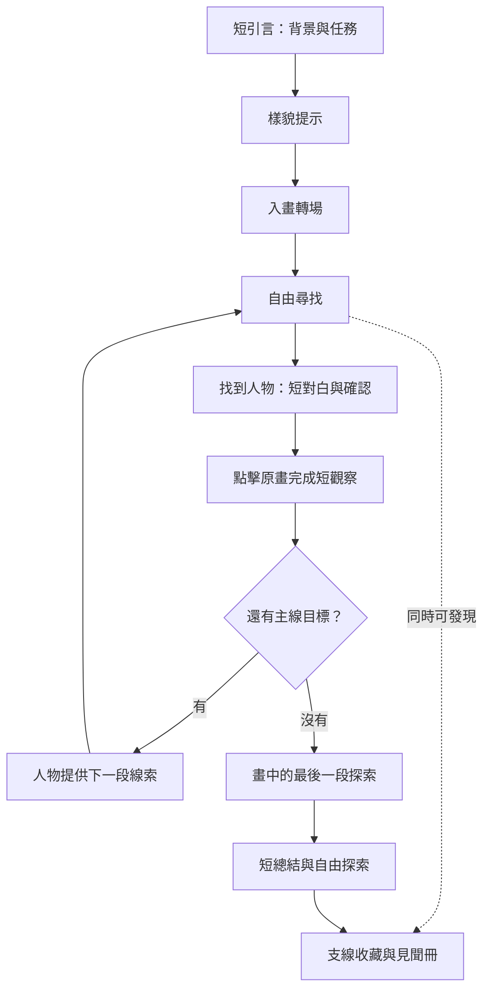

# 畫中尋人：歷史畫作章節製作標準

版本：1.1｜2026-10-23

基準章節：《宮中鬧元宵》／《憲宗元宵行樂圖》  
對象：初中學生  
用途：後續畫作的選題、玩法、文案、美術、動畫及實作依據。

本規範整理使用者已確認的設計方向，以及由此制定的新章節預設值。它不是所有舊版畫面的紀錄，也不代表已完成學生試玩或所有裝置的驗證。基準章節已完成；後續製作以新章節為工作對象。

2026-10-23 封存補充：六個已上線章節以 `site-2026-10-23`（`c9e99bfbc13322269c29d5d0d12071c739c3b828`）為正式保存基準。沒有使用者明確的新修改指示，不改動其定稿畫面、流程及背景音樂；共用介面與音樂引擎的調整亦不能改變這份定稿。後續新增章節保持獨立，若使用者日後要求修改既有章節，另存版本並保留此封存。見[正式封存紀錄](releases/site-2026-10-23.md)。

2026-10-23 最新定稿：目前維護與新增畫作的封面、導航以 `site-2026-10-23-zanhua-navigation`（`222747b2e999e09f666073460a58d80294123c35`）為準，包含簪花最新修訂；上一份封存仍保留。見[本次正式封存](releases/site-2026-10-23-zanhua-navigation-archive.md)。

## 1. 核心原則

**玩家在真實畫作中尋找人物，透過點擊、觀察與收藏，逐步理解這幅畫值得探究的地方。**

1. 原畫是主場景，也是解說的證據。
2. 主線維持 Where is Wally 式的視覺尋找；線索幫助辨認，保留自行尋找的空間。
3. 以一次一個問題、一段短對白、一個操作控制資訊量。
4. 觀察是必經環節，操作直接對應眼前原畫。
5. 支線自由發現，收藏提供持續探索的動機。
6. 回饋清楚，視覺安靜；動畫交代發生了甚麼。
7. 結尾留在畫中，將發現連回原畫細節。
8. 每幅畫都有自己的問題、角色及節奏；通用原則與畫作內容分開設計。

## 2. 必須沿用與可以調整的內容

| 必須沿用 | 按畫作調整 |
|---|---|
| 真實畫作、可信來源、保留原畫完整構圖 | 畫作、年代、場景與探究問題 |
| 玩家自行拖曳、縮放、凝神探索 | 展卷方向、起始視角與導覽地標 |
| 預設凝神，右上可轉回彩色 | 凝神光區大小與明度 |
| 樣貌優先、分層提供提示 | 找誰、找幾次、是否為同一人 |
| 找到後短回饋，再完成原畫觀察 | 觀察衣紋、器物、動作、空間或人物關係 |
| 可探索人物有自己的回應 | 語氣、角色設定、下一段線索 |
| 同類線索多處可收集、同類只計一次 | 收藏類別、數量、圖樣與完成獎勵 |
| 人物短對話框、畫旁題箋、見聞冊分工 | 紙絹色調、少量章節裝飾與冊名 |
| 動畫原位演繹，完成後回到原畫 | 值得演繹的動作與是否需要動畫 |
| 最後一段探索在畫中完成 | 收尾問題、歷史意義、探索順序 |

《宮中鬧元宵》的三次皇帝身影、三個庭院、六類收藏及元宵題材都屬本章內容。後續章節不必照搬。已刪除的收尾「細看畫法」不納入通用流程；畫法可以在合適的原畫觀察中自然帶出。

## 3. 選畫標準：先回答為何值得玩

每幅候選畫作必須先回答：

- **獨特性：**有甚麼值得初中學生探究，而且能從這幅畫看出來？
- **尋找性：**人物或物件夠多，特徵可辨認，能形成有難度的視覺尋找嗎？
- **證據性：**至少能把兩個有意義的發現指回具體位置嗎？
- **素材性：**能取得完整畫面、足夠清晰的局部、來源及使用條件嗎？
- **範圍：**畫面複雜程度與學生的操作負擔是否合適？

先寫一句章節命題：

> 在《＿＿》中尋找＿＿，從＿＿與＿＿，理解＿＿。

再列「原畫位置 → 可見細節 → 可支持的解讀 → 資料來源」。人物不足、細節看不清或命題只能靠長篇文章交代的畫作，先更換選題或縮小設計範圍。

## 4. 素材與歷史資訊

- 主場景使用完整原畫；高清局部只能按原畫特徵定位，保留全畫底圖。
- 保持比例與人物關係；展示用灰階、明暗及鏡頭變化不修改原始圖檔。
- 接縫、色差、低清區域要留下記錄；不以生成的高清細節冒充原畫證據。
- 每個素材記錄來源網址、收藏機構、取得日期、尺寸、裁切位置與使用條件；未確認的資訊明示待查。
- 文案區分三種內容：**原畫可見事實／有來源的歷史解說／遊戲虛構對白或演繹**。
- 不替畫家杜撰創作動機，不把宮廷安排的場景直接當成整個社會的實況。
- 生成素材可用於介面、辨認輔助圖、收藏圖樣及動畫；須標明用途，保留原畫對照。

## 5. 章節流程

- 引言只交代「這是甚麼畫、此刻在做甚麼、要找誰、為何值得看」；深入資訊放在發現之後。
- 引言由玩家推進，素材載入妥當後才可入畫。
- 一次只啟用一個主線目標。點中後確認成功，玩家主動近看才移動鏡頭。
- 每次觀察只要求一個清楚操作，例如點衣袍看灰階、點兩處比較、點物件看動作。
- 完成操作才出現一句解讀及繼續入口；避免額外長篇必讀內容。
- 下一段線索由角色自然提供，指向場景或活動，讓玩家自行判斷位置。
- 主線完成與收藏集齊是兩個獨立狀態；不用收齊支線才能完成主線。

### 封面與跨章導航

使用者於 2026-10-23 正式確認：後續新增畫作沿用本次已上線的封面與導航設計。

- 封面沿用原畫背景、淡絹漸層、直排章節題名、短引言、現行字體與留白，以及一個主要入畫操作；按畫作替換原畫、章名、背景文案與任務，不另建展示網站式首頁。
- 底部沿用 `ChapterLinks` 的安靜章節名稱導航，當前章節以朱色細線標示。新增畫作只擴充章節資料與入口；保留窄畫面水平捲動、可見焦點與目前章節標記。
- 收尾提供「回到本章封面」，玩家可留在畫中探索，也可回封面再選另一幅畫。回封面沿用現有轉場，保留收藏；簪花清除 scene/person 預覽參數的處理按該章需要保留。
- 案桌、藏卷架、逐卷開啟選畫與獨立卡片目錄均為未採用的設計歷程；現行簡約封面和底部導航是實作基準。
- 參考：`src/components/ChapterLinks.tsx`、`src/styles.css`、各章現行引言與 `src/game/chapterCover.ts`。獨立文件形式的章節從其正式來源同步同一導航，保留宿主切換能力。
- 代表畫面：`output/gameplay-preview/zanhua/v0.41-2026-10-23/cover-navigation.png` 與 `live-cover-navigation.png`。

## 6. 尋人與提示

- 起始提示以眉眼、面形、鬚髮等辨認特徵為主；只展示必要的頭部範圍。
- 原畫裁圖清晰度不足時，可用清晰的樣貌摹繪；標示「樣貌摹繪，原畫為準」。摹繪不能改變關鍵辨認特徵。
- 人像需乾淨去背、保持合理尺寸；不放大低像素臉部，也不一開始洩露全身衣著、姿勢與位置。
- 提示逐步增加：**樣貌 → 衣著或動作 → 地標或大致區域**。
- 玩家主動要求才移到大致區域；不圈出答案、不自動帶到正確人物。
- 尋人卡只顯示人像、當前任務、短線索與主線進度。
- 點錯以人物語氣回應；不扣分、不懲罰、不把整場變成答題。

## 7. 人物回應與覆蓋

- 製作時逐段盤點全部可辨識人物，清晰人物預設都可點擊，並有自己的熱區與對白。
- 太小、被遮擋而暫不互動的人物須列入覆蓋表並交代理由；不能用少數大熱區假裝覆蓋整群。
- 每位人物預設至少三句：首次招呼、再次點擊、後續回應。內容來自其手中物、姿勢、工作或周邊活動。
- 角色可以幽默，保持短句與自然語氣；避免所有人輪流重複「不是我」。
- 回應可以引導觀看，但不直接揭露主線答案。
- 一個人物同時帶有支線時，**人物說話**與**收藏成功通知**分別呈現。
- 虛構對白在說明或語意標籤中交代；不當作歷史人物的真實語錄。

## 8. 支線、收藏與見聞冊

### 收集規則

1. 收藏項目代表一類見聞，如「花燈」；每個花燈位置是該類見聞的一個實例。
2. 建立 `收藏類別 ID → 多個熱區 ID` 的對應。點中任何相應實例都可首次解鎖。
3. 同類只計一次；已收集後點另一處仍有回應，例如「這裡也有花燈，已記在冊中」。
4. 系統記住首次發現位置，冊中可回看該處原畫。
5. 同一位置可能有多類線索；需明確分開物件熱區與人物熱區的優先關係，不能以大人物熱區遮住物件。
6. 完整盤點重複物件，尤其花燈、樂器與道具；不能只登記一個示範位置。

### 首次收藏的回饋順序

**點擊處顯現圖樣 → 圖樣縮小飛入冊子 → 冊子接收、數量更新 →「已收藏：名稱」通知。**

- 先提交收藏狀態，再播放動畫；連點只解鎖一次。
- 圖樣飛行目的地對應實際見聞冊按鈕，視窗尺寸變化後重新計算。
- 重複點擊使用較輕的動畫與「已記在冊中」通知，數量不增加。
- 減少動態或動畫失敗時，仍更新冊子並顯示成功文字。
- 收藏數量與可回看的項目按章節保存；換畫作不能共用同一組存檔鍵。
- 「再尋一次」預設重設主線，保留收藏；若提供清空收藏，須是另一個清楚的操作。

### 冊子版面

- 桌面維持「原畫＋閱讀／收藏區」的 B 方向；收藏區具足夠不透明度，背景線條不能穿過文字。
- 總覽以圖樣、短名稱、進度為主；項目用網格和留白對齊，不堆疊卡片。
- 未發現：淡墨輪廓與短提示。已發現：彩色圖樣與小印記。不能只靠顏色表示狀態。
- 詳情呈現收藏圖樣、原畫位置、一句觀察及短解說；資料來源可展開。
- 收藏數量按畫作內容決定，不固定六格；集齊可以解鎖紀念頁，不增加必讀負擔。
- 合冊恢復原來鏡頭與凝神／彩色設定。

## 9. 視覺元件分工

| 元件 | 內容 | 呈現原則 |
|---|---|---|
| 尋人卡 | 樣貌、任務、線索、進度 | 小型角落元件，原畫仍占主要視野 |
| 人物對話框 | 角色短對白及一個接續操作 | 淡絹底、細墨邊、小尖角指向人物 |
| 畫旁題箋 | 觀察問題或歷史解讀 | 在相應細節旁，內容決定高度 |
| 收藏通知 | 新收藏／已收藏及名稱 | 固定安靜位置，短暫顯示，不擋操作 |
| 見聞冊 | 收藏總覽、單項詳情 | 原畫與收藏區並置；手機上下排列 |
| 完成按語 | 本章發現及探索出口 | 在畫中，保持眼前細節可見 |

- 原畫線條、絹紙、淡墨與少量朱色是基準語彙；章節色調從新畫作取得。
- 邊框與收藏圖樣可以用美術圖；需要改動、縮放、翻譯或朗讀的文字保持活字。
- 完整文字美術卡僅限固定內容、效果已確認的個別素材；另外提供語意文字及可用的按鈕。
- 不用巨型標題、厚重深綠塊、強光暈、繁複金框與卡片套卡片。
- 主線人物與其他人物共用對話框語彙；系統通知不混入角色對白。
- 對白優先放人物旁空位；尖角指向說話者。縮放、平移後跟隨原畫座標，不遮住臉、辨認特徵或待點物件。
- 桌面對白盡量一行；窄屏可以兩行，不能為維持一行把字縮得難讀。

## 10. 文字與排版預設

**2026-10-12 使用者補充：**《宮中鬧元宵》的現行介面是整個遊戲的標準。後續章節須沿用其按鈕、手繪圖示、提示卡、原畫題箋、人物對白、見聞冊、字體及操作層級的共用樣式與素材；不得以獨立效果稿或相近的自訂樣式代替。章節原畫、人物、文案及收藏圖樣按畫作替換，幾何位置按實際原畫調整。以下建議值不能取代現行介面標準。

下表是後續章節的起點，並非對現有全部 CSS 數值的逐項複製。

| 文字用途 | 建議大小 | 字體與排列 |
|---|---|---|
| 原畫人物短對白 | 16–18px | 文楷、正常字重、行高 1.5–1.65 |
| 畫旁解說正文 | 18–20px，優先 20px | 清晰宋體或文楷，行高 1.65–1.85 |
| 題箋標題 | 20–24px | 宋體，正常或中等字重 |
| 主要操作 | 15–16px | 一個短動詞句，按鈕熱區不因小字而縮小 |
| 進度、補充與來源 | 12–14px | 清楚可讀，次要墨色 |

- 全章以兩套相容字體為上限；實際載入的字型與備用字型需記錄。
- 一段對白約 8–18 個中文字；一則題箋先以 30–50 字、兩至三行為目標。超出時分步或改為選讀。
- 一次只呈現一個主張與一個主要操作；標題不要重複正文。
- 先定可讀字級再縮短文案，不以縮字解決擠迫。
- 留白按 8／12／16／24／32px 級距安排；題箋內距預留美術圖毛邊。
- 桌面題箋約 350–420px 寬，按內容調整；手機留左右安全距並保留原畫可見區。
- 呈現於圖上的文字必須有安靜底色，不讓地磚、欄杆與衣紋穿過文字。

### 後續共用設計值

以「基礎值 → 用途 → 元件」三層管理字體、顏色、間距與動畫。例如絹色基礎值對應閱讀背景，再對應題箋和通知背景。章節只調整必要的基礎色，不各自發明一套元件。

基準配色可參考：絹色 `#f1ead7`、墨色 `#384333`、次要墨色 `#696f58`、收藏朱色 `#93513d`。必須在新畫作背景上重新檢視可讀性；這些數字不是每幅畫必須相同的顏色。

## 11. 轉場與原位動畫

| 情境 | 順序 | 新章節起始時長 |
|---|---|---|
| 引言入畫 | 原畫準備好 → 引言淡去 → 操作開放 | 約 900–1100ms |
| 近看或切換細節 | 文字先淡出 → 鏡頭移動 → 停定後文字淡入 | 淡出 160–200ms；鏡頭約 440–650ms |
| 首次收藏 | 圖樣顯現 → 收入冊子 → 接收與通知 | 飛行約 1200–1500ms；通知約 3秒 |
| 重複發現 | 輕回應 → 較短收藏確認 | 約 900ms；通知約 2秒 |
| 合冊 | 詳情淡去 → 回到原位置 → 恢復探索 | 同近看轉場 |

- 動畫表達玩家的操作結果；避免同時移鏡頭、換段落和播放人物動作。
- 轉場中阻止同一操作重複觸發，完成後恢復互動；不留下永久不可點的狀態。
- 動畫只在合適的畫中物件被點擊後播放，例如貨郎展示小物或雜技上下配合。
- 以原畫姿勢與物件關係作依據；固定底座、繩子等錨點，不加入沒有依據的表演道具。
- 分層去背、同色調、同紋理、同尺度；靜止時不應看到矩形補丁、接縫或重複人物。
- 原位演繹宜短，約 3–5 秒，可重播；結束恢復原畫，短解說隨後出現。
- 標示為遊戲演繹；動畫提供觀看趣味，原畫仍是學習證據。
- 減少動態時使用直接切換或短淡入，保留相同的完成、收藏和繼續能力。

## 12. 收尾原則

- 收尾是畫中的最後一段探索，沿用原畫、鏡頭和題箋，不另開大篇幅結業頁。
- 每句解說都對應此刻可見的細節；需要比較時，由玩家選擇回看。
- 先回顧本章核心關係，再探索有代表性的生活或歷史細節；順序按畫作決定。
- 可用簡短判斷問題鼓勵解讀，但不為每幅畫固定增加選擇題或畫法教學。
- 最後只留下兩至三個發現，清楚提供「自由探索」「回到本章封面」；回看見聞冊與再尋一次沿用現有操作層級。
- 資料來源與延伸閱讀收在可展開內容，避免一次顯示全部資訊。

## 13. 互動、狀態與素材結構

- 使用畫作座標登記熱區；縮放和平移時，人物、物件、尖角、題箋與動畫共用同一座標轉換。
- 分開四類狀態：主線目標、必經觀察、收藏、鏡頭／介面。冊子和動畫不得改變主線答案。
- 熱區用輪廓或適當矩形，處理重疊、觸控誤點與小物件；背景點擊不誤觸大熱區。
- 全章的熱區表包含：唯一 ID、角色或物件、位置、對白、收藏類別、來源局部、首次／再次回應。
- 收藏、動畫、載入失敗都必須有文字狀態；網路或存檔不可用時，當次遊戲仍可操作。
- 載入、過渡、閱讀、探索、完成、重玩各有清楚入口和退出方式。
- 音樂由玩家開啟；畫面閱讀時保持安靜，不以聲音作唯一提示。
- 每個畫作章節使用自己的背景配樂，沿用現行手繪音樂開關與共用播放引擎。曲目來源、作者及授權保存於 `public/audio/CREDITS.md`，章節來源說明同步署名；現代配樂不當作畫中曲目的復原。
- 鍵盤能操作重要功能，焦點可見；按鈕有清楚名稱。手機點擊熱區以約 44px 為起點，細節過密時先讓玩家放大。
- 重要成功通知提供可朗讀文字；圖像有用途說明，不只依賴顏色或動畫。
- 章節素材和文案與通用元件分開；先參考基準元件，再決定是否真的需要新元件。

## 14. 新章節製作流程與交付

1. **選題：**完成選畫理由、來源與本章命題。
2. **盤點：**看全畫並逐段標記人物、主線候選、支線及全部重複線索。
3. **設計：**寫主線、觀察、對白、收藏和畫中收尾；使用[章節模板](templates/historical-painting-chapter-template.md)。
4. **效果稿：**先展示尋人卡、人物對白、題箋、冊子和收尾代表畫面；動畫先選一個重點做樣段。
5. **製作：**完成美術素材、去背、熱區與文案，串接流程及轉場；新章節獨立入口，不改動完成的基準章節。
6. **檢視：**逐段記錄互動覆蓋、重複收藏回應、文字位置、動畫接縫、裝置及載入狀態。
7. **定稿：**保留最終效果、素材來源、文案及已知限制，記錄使用者最後確認版本。

交付至少包含：章節設計文件、來源清單、熱區／收藏對應表、對白表、美術與動畫素材記錄、代表畫面、已知限制及版本記錄。沒有執行的檢查不得標為通過；學生完成時間與難度需由實際試玩確認。

## 15. 定稿檢視清單

- [ ] 能用一句話說明為甚麼這幅畫值得探究。
- [ ] 原畫完整、來源清楚；摹繪與演繹用途標明。
- [ ] 開局任務清楚，提示先樣貌，玩家保有尋找難度。
- [ ] 主線觀察直接對應原畫，每一步資訊量受控。
- [ ] 人物對白有差異，尖角位置準確，沒有遮臉或擋待點細節。
- [ ] 重複線索逐一登記，任何相應位置都能收集或回應，數量不重複增加。
- [ ] 收藏飛入冊子，文字確認明確，冊子可回看發現位置。
- [ ] 正文可讀、留白足夠，手機無裁切，字體不混亂。
- [ ] 轉場順序清楚，原位動畫沒有背景色塊或接縫，結束恢復原畫。
- [ ] 減少動態、鍵盤及載入失敗時仍能繼續。
- [ ] 收尾在畫中，解說對應可見細節，完成後仍可探索。
- [ ] 主線／收藏存檔與重玩規則明確，沒有跨章污染。

## 16. 基準實作參考

| 參考 | 用途 |
|---|---|
| `src/components/LanternGame.tsx` | 引言、探索、主線與收藏協調 |
| `src/components/ScrollScene.tsx` | 全畫、縮放、拖曳、凝神與鏡頭 |
| `src/components/LanternEmperorSpeech.tsx`、`src/game/lanternReply.ts` | 主線短對白與人物旁定位 |
| `src/components/LanternDiscovery.tsx` | 必經原畫觀察與下一段線索 |
| `src/components/LanternPaintingNote.tsx` | 畫旁題箋 |
| `src/components/LanternEpilogue.tsx` | 畫中收尾；已移除「細看畫法」 |
| `src/game/lanternCollection.ts` | 收藏類別、重複位置、首次發現位置 |
| `src/components/LanternSparkDiscovery.tsx`、`LanternNotice.tsx` | 收入冊子與文字確認 |
| `src/components/LanternJournal.tsx` | 見聞冊總覽與詳情 |
| `src/components/LanternMarketAnimation.tsx`、`LanternAcrobatAnimation.tsx` | 原位分層演繹 |

以上用作成熟例子。新章節資料應獨立；不要把皇帝、元宵或固定收藏數量硬編入共用流程。舊設計文件與預覽只作歷程參考，後續方向以本規範及使用者的新指示為準。
