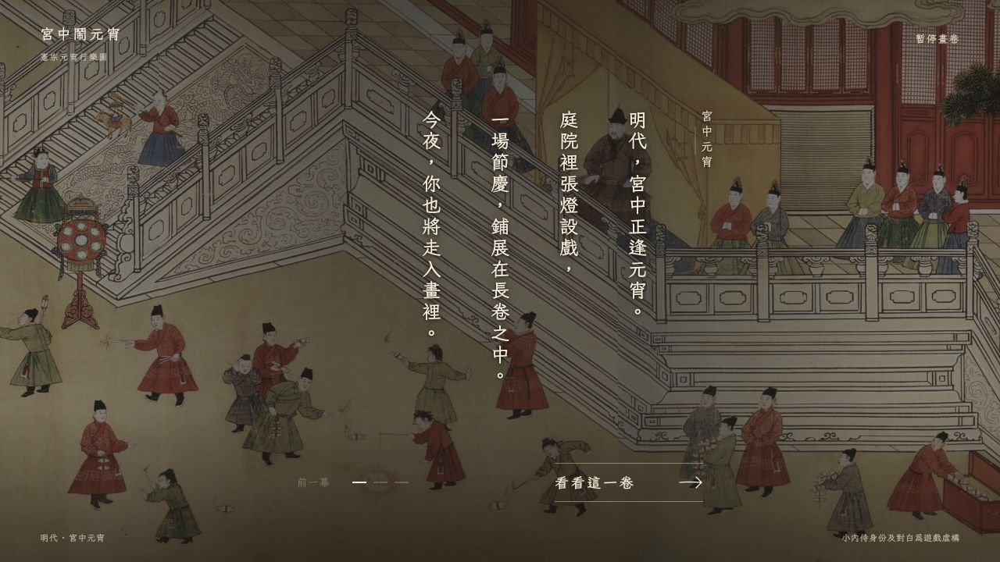
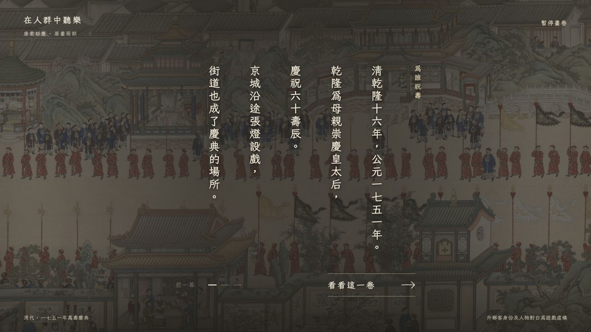

# 兩章三幕入場：正式封存與後續製作基準

日期：2026-10-27。使用者確認將目前《宮中鬧元宵》與《在人群中聽樂》的三幕入場設計正式封存，作為後續畫作章節的製作基準；其他章節暫時不改。

共同封存標記：`site-2026-10-27-three-act-entry-baseline`。此標記保存兩章目前上線內容、製作來源、既有素材及本次製作規範；原有各章發布標記、舊版及先前封存均保留，不移動或覆寫。

## 固定版本

| 章節 | 封存版 | 三幕 | 玩家身份 | 原正式部署提交 |
|---|---|---|---|---|
| 宮中鬧元宵 | `lantern-three-act-v1`／1.1.0 | 宮中元宵 → 畫中元宵 → 初次隨行 | 初次隨行的小內侍 | `1026563b73501884d1664053970ccd38ec17c6f2` |
| 在人群中聽樂 | 2.2.0 | 為誰祝壽 → 畫中一街 → 外鄉來客 | 初到京城的外鄉客 | `b150a346bee6cc017de1e1fb36b3e578fde1c9f9` |

- 宮中正式入口：<https://vincentttchan.github.io/chinese-wally/#lantern-festival>；其 1.0.0 獨立版及 `#lantern-festival-legacy` 舊流程繼續保留。
- 康衢正式入口：<https://vincentttchan.github.io/chinese-wally/#kangqu-listening>；2.1.14 舊版保留於 `chapters/kangqu-listening-v2-2.1.14/`，更早的原上線版亦保留。
- 本次文件提交前的保存基底是 `cd48c610c7abd3f1f02ecef5aa62dd88739559df`，與上述兩章最新正式部署內容一致。
- 原始版本記錄中的 `release-candidate` 或「另一章仍待審視」屬建立當時的歷史註記，原樣保存；目前狀態以本次使用者確認及正式部署記錄為準，不回寫已發布的執行文件。

## 後續畫作沿用的設計

**現行封面 →「走進這一卷」→ 交疊展卷 → 歷史背景 → 畫作背景 → 玩家身份與任務 → 原畫尋人。**

1. 保留現行原畫封面、直排章名、短引言與底部章名導航；原畫與字體就緒後才交疊淡入，第一幕逐字呈現接在過渡之後。
2. 三幕各有一個清楚目的：交代場景背景、認識眼前畫作、建立玩家身份與首個任務。不把成畫年份和活動年份混為一談；已核實資料、可見事實及虛構身份／對白分清。
3. 沿用直排七欄格線；同一視窗尺寸下，各欄頂端、欄距、各幕起筆位置一致。出字只改可見程度，不改字位；短幕不重新置中，末段不額外下移。
4. 沿用逐字、標點及欄尾停頓。「顯示全文」完成當幕後，玩家再按才進下一幕；可回前幕，不自動跳幕。
5. 原畫向右緩移，文字固定；換幕保持鏡頭連續，保留暫停／繼續。取景、比例及位移按各幅原畫計算，不照搬另一幅畫的座標，不補繪原畫像素。
6. 第三幕自然接到本章第一個樣貌提示與尋人任務，鏡頭交接避免跳切。回封面可重新播放入場，保留收藏與原有音樂操作；減少動態時使用靜止原畫及全文。
7. **身份按畫作另想。**小內侍與外鄉客是兩個已確認例子，後續章節選擇與場景、觀看動機、主線任務呼應的身份，不固定複製其一。

具體動作、字體、節奏及取景以封存來源為準。約 1050ms 封面交接、52 秒背景緩移、1100ms 入畫淡出及七欄版面作新章實作起點；文案與實際畫面的可讀性仍須個別確認。不得為抽取共用元件、整理或優化而改動這兩章定稿。

## 保存內容與使用方式

- [製作標準 1.2](../historical-painting-chapter-standard.md)：新增「三幕入場基準」與現行流程，其他原有玩法原則保留。
- [更新後章節模板](../templates/historical-painting-chapter-template.md)：填寫身份、三幕逐欄文案、來源、取景、逐字與過渡、回封面、沿用元件及封存版本。
- [逐欄定稿文案](three-act-entry-baseline-2026-10-27/confirmed-copy.json)：直接從兩份正式入場來源抽取，包含六幕原文、幕名、操作、頁腳說明與身份，不重新編寫文案。
- [保存清單與指紋](three-act-entry-baseline-2026-10-27/manifest.json)：記錄製作來源、正式獨立文件、版本清單、舊版文件及代表畫面的 SHA-256；完整原畫、字體、音樂與共用素材由共同 Git 標記保留。
- React 形式以 `src/components/LanternThreeActEntryV1.tsx`、`lantern-three-act-entry-v1.css` 及 `LanternThreeActGameV1.tsx` 為參考；獨立文件形式以 `src/entries/kangqu-three-act-v2.2.0/` 為參考。兩種形式沿用同一視覺與互動設計，不強制改寫任一已完成章節。
- HTML 仍引用其原素材目錄；不能只取單一 HTML 就宣稱已保存完整可離線版本。康衢的 `kangqu-listening-v2`、`kangqu-listening` 目錄亦被封存版引用，不可刪除或覆寫。

代表效果是前次正式上線時已保存的畫面，本輪沒有重新遊玩或新拍畫面：

## 本次範圍與限制

只更新封存、製作標準、章節模板及工作原則；`src`、`public` 的 Git 樹與封存前相同。兩章目前的畫面、文案、動畫、流程、收藏、音樂、導航，以及《簪花仕女圖》《洛水之間》《清明上河圖》《榜下尋人》均沒有改動。本次不重新部署網站。

本輪只核對文件與來源指紋，沒有執行建置、測試套件、新裝置檢視或全章通關。實際遊玩及部署確認沿用[宮中 1.1.0 發布紀錄](lantern-three-act-v1.1-2026-10-27.md)及[康衢 2.2.0 發布紀錄](kangqu-three-act-2.2.0-live-2026-10-27.md)，不擴大其已確認範圍。

使用者日後要求改動時另存新版本並保留本次封存；後續畫作新增三幕入口時，不自動修改其餘已完成章節。
