# 簪花七項修改 · 實際審視

日期：2026-11-11。版本：本機 `8ab23ac`（程式提交 `8eed427`）。本次沒有改遊戲或部署。

## 結論

第一人物衣飾可正常走到第二人物，小犬即時收藏、單擊披帛、新見聞冊和觀畫長河均已接入。仍有三個明確問題：扇子收藏入口不一致、章末自選紀念打斷續玩、較高較窄視窗的畫坊黑邊。另有侍女動畫融合與推進層級的設計問題。

## 步驟與狀態

1. 畫坊點燈→開門→走近書案→身份對話→蓋印：可完成；目前 791×853 視窗上下大幅黑邊，場景只約 447px 高。
2. 封面→三幕→原畫尋人：正常；第三幕已聚焦袖口、裙襬、衣料層次，重複交接頁沒有出現。
3. 第一人物→小犬→紅裙→寬袖→手臂下方披帛→第二人物提示：可完成；小犬收藏由 0/4 成為 1/4；披帛一次點擊可開說明。衣飾後能以線索引導下一件。
4. 侍女支線→演繹→對白→長柄扇說明→回原畫：可完成，仍有收藏不一致；人物沒有整體搬到前景，但腳邊淡化和立繪明度仍可見替換層，扇面輕動缺乏手部連動。
5. 見聞冊概覽→小犬詳情→原畫位置→繼續閱讀→關閉；畫卷操作開關：可完成；書本比例、圖文分頁與紙箋層級較清楚。
6. 章末對話→選擇題→錯答說明→蓋印→自選紀念：可完成，但續玩被紀念邀請打斷，關閉後需重按原按鈕。
7. 展開長河→點宮中：正常；第一卷已藏、第二卷可進，第三四卷無名稱且禁用；進入宮中封面。

## 優先問題

### P2 · 已讀長柄扇，見聞冊仍未收集

復現：由「查看執扇侍女」入口完成動畫，點「細看長柄扇」，讀完說明，再開見聞冊。長柄扇仍為灰色未發現，總數維持 1/4（只有小犬）。直接點扇子和點人物得到相同演繹與說明，卻有不同收藏結果。

來源：`src/components/ZanhuaThreeActGameV1.tsx:204` 按入口傳入 `collectFan`，`:217` 只有 true 才儲存。建議在實際讀到扇子說明時統一記錄一次，收藏類別去重沿用。

### P2 · 自選紀念與下一卷操作競爭

復現：蓋印後出現「聽他說下一卷」，按下後畫面先被觀畫帖接管。選「先留待貼」只回到帖的概覽，再「合上」後仍停在「今晚讀過的第一卷，收好了」。要再按一次「聽他說下一卷」才見下一段。

來源：`public/atelier/opening-zanhua-refinement-v1.js:87` 延遲開紀念邀請，與 `:354` 下一步處理並行。建議把紀念邀請放成固定的一步，完成或略過後立即接下一卷對話；不要由延遲彈出攔截續玩。

### P2 · 較高較窄視窗仍有黑邊

本次入口實際視窗 791×853，上下合計約 406px 深色區，與使用者要求善用瀏覽器空間不符。1440×900 的遊戲原畫沒有同樣問題。不能單純拉闊人物或放大裁掉門；需依視窗重排入口構圖與取景。

來源：`public/atelier/style.css:36` 固定 stage 比例1672/941並置中。修正須維持點燈、開門、案前鏡頭的共同空間座標。

### 視覺與節奏改善

- 侍女：已取消全身抽離，但腳邊局部消融、立繪與底圖色階不一致仍顯眼；應統一貼合，再做持扇手與扇柄的小幅連動。
- 衣飾：目前對白→「讓我看看」→線索卡→點衣物→說明→「下一步」→對白，切換層級仍多。可保留人物一句線索，直接在原畫開放觀察；讀完後「下一步」回到下一條線索，減少重複確認。

## 本次截圖

### 1. 畫坊入口：較高視窗黑邊
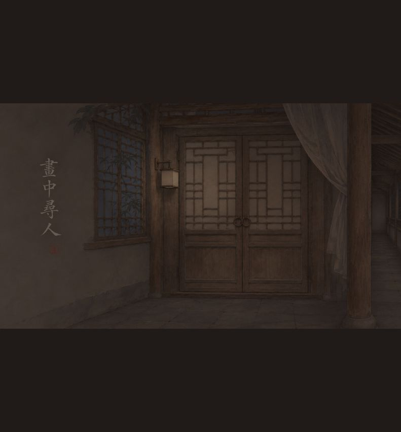

### 2. 第三幕：衣着任務
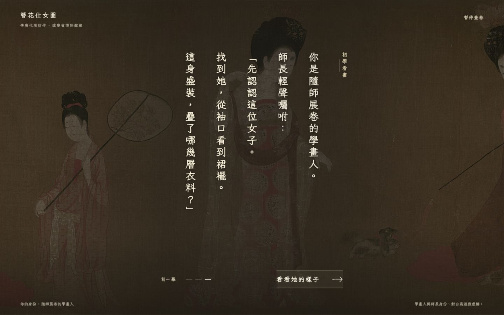

### 3. 原畫觀察：橫向短提示
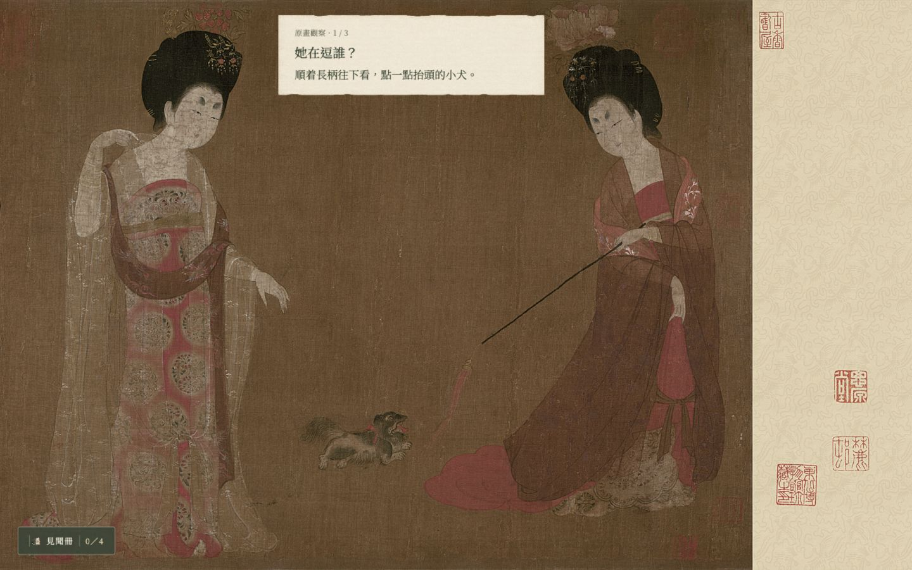

### 4. 衣物細看：短說明及主要出口
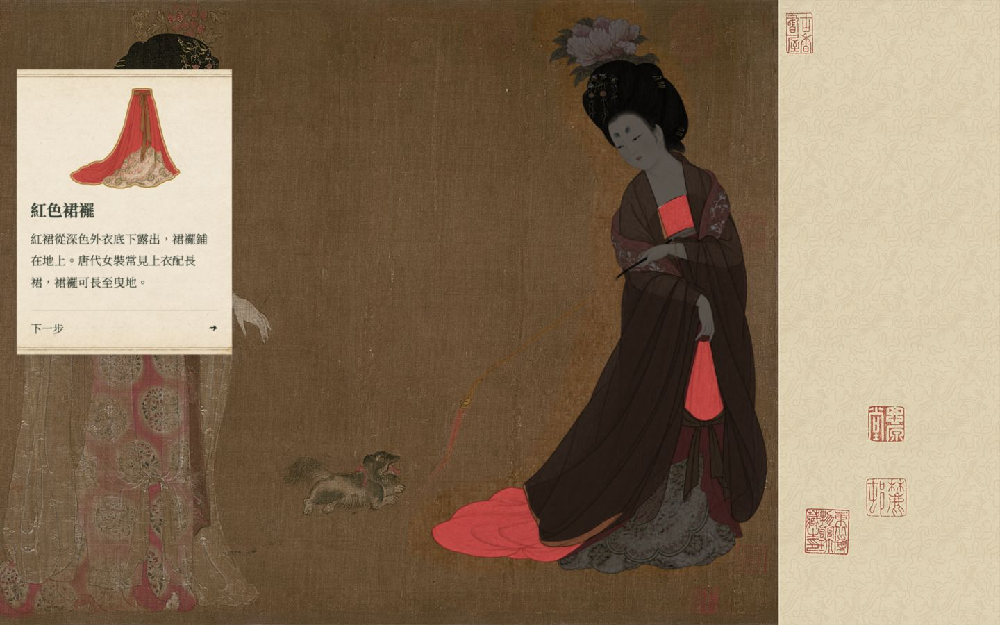

### 5. 侍女：原位演繹抽樣
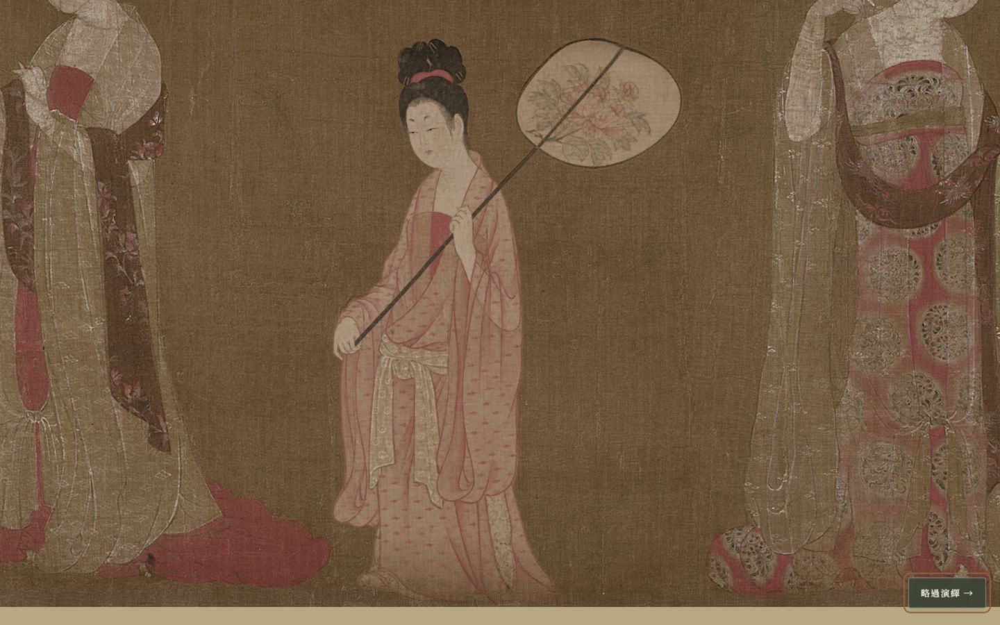

### 6. 見聞冊：讀過扇子後仍灰色
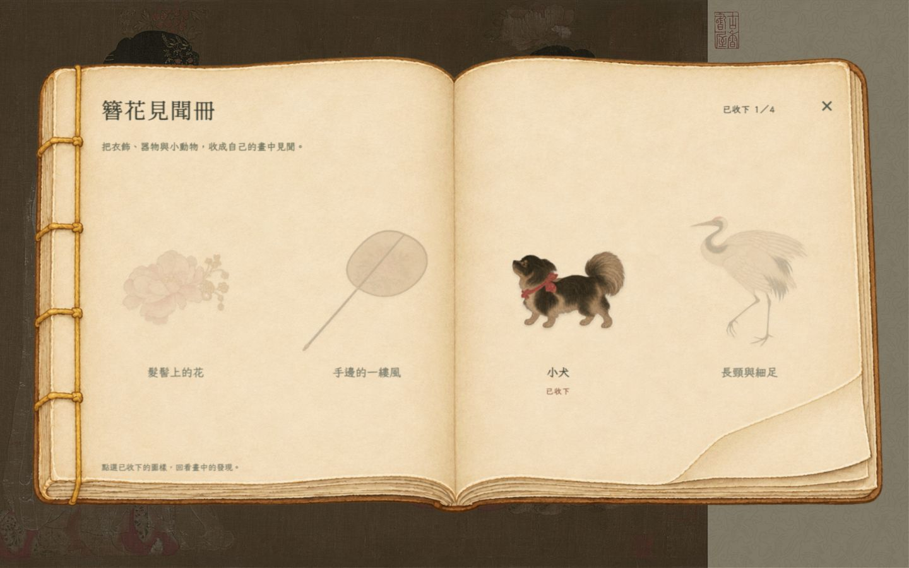

### 7. 見聞冊：圖文分頁
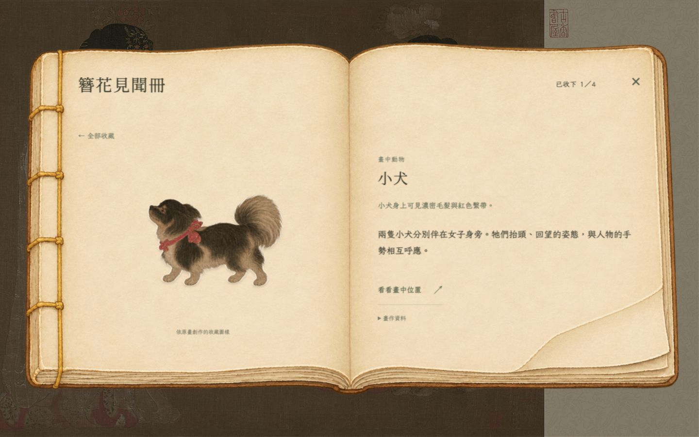

### 8. 章末：對話後選擇題
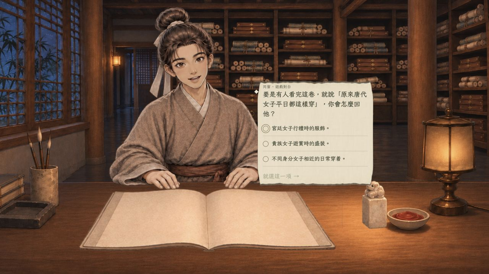

### 9. 下一卷操作被紀念邀請接管
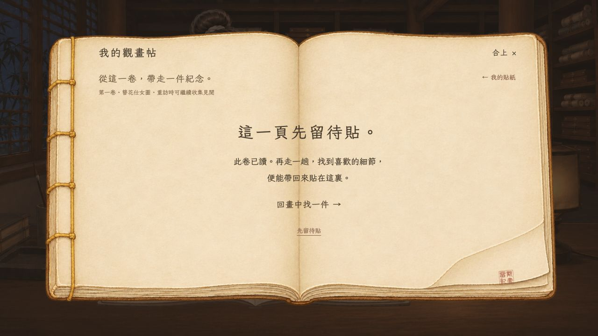

### 10. 長河：解鎖與名稱隱藏
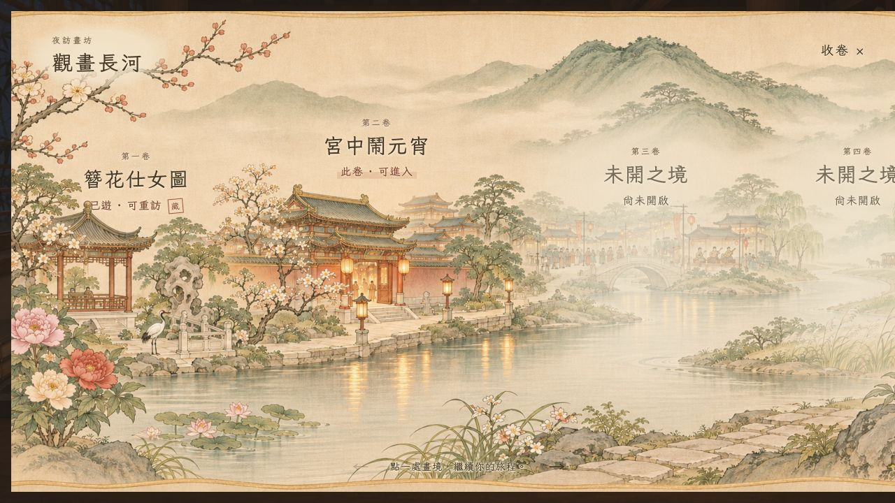

### 11. 畫卷操作：右側紙箋
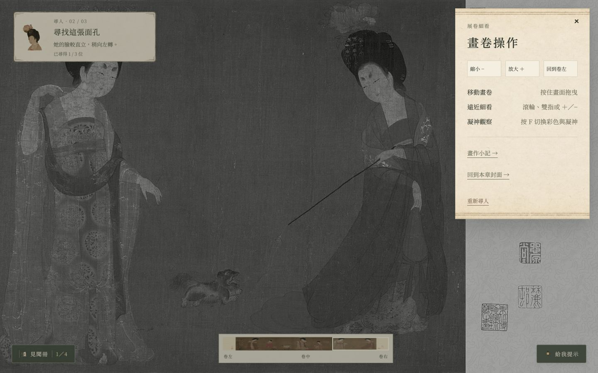

## 驗證界限

- 第一人物衣飾使用實際入場一路操作，沒有注入遊戲狀態。
- 章末以既有 `?return=zanhua` 本機入口另作定點檢查；這是新隔離存檔，沒有收集任何元素，因此帖的空白狀態屬測試條件，沒有把它當成收藏遺失。未重新完整通關三位人物及其畫中回望。
- 未回歸所有章節／正式站／完整重訪存檔；沒有聲稱全流程驗收完成。
- 本次兩個測試分頁沒有瀏覽器 console error。
- 可觀察到部分鍵盤操作及焦點返回可用；未作螢幕閱讀器、對比量測、完整WCAG驗證。未收集元素的淡色圖及小字有可讀性風險，但非本次優先阻塞。
